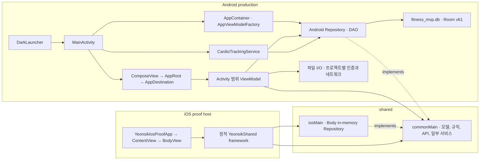

# FitnessApp Android·iOS 통합 아키텍처

**1차 저장소 탐사 보고서 · MODE A · 2026-11-18 KST · 정합성 보완 2026-11-18**  
대상은 `Yeon-sik/Yeonsik-Fitness-App` 원격 `main`의 [`0b47010c3afbca14792dff162ddc46bf1819563b`][commit]이다. Android의 실제 사용자 흐름과 기존 기록을 보존하면서 하나의 FitnessApp을 두 운영체제에 제공하기 위한 판단 근거를 정리했다.

> **정합성 보완.** 같은 기준 커밋으로 사실 주장, 기존 링크 137개(보완 후 156개)와 줄 앵커를 재대조했다. 반박된 사실은 없다. 다음을 추가하거나 고쳤다: 구조 규칙 Source of Truth와의 충돌(B·I·L), 공용 UI 기반 인벤토리(D), 작업 브랜치 차이(B), Compose Multiplatform 버전 선택지(C), iOS Body 화면의 저장소 수명(G), 증거 등급 표기, 어긋난 줄 앵커. 보완 작업에서도 저장소 변경은 없다.

[A. 요약](#a-executive-summary) · [B. 기준선](#b-verified-baseline) · [C. 현재 구조](#c-current-architecture) · [D. 화면 목록](#d-complete-ui-inventory) · [D. 공용 UI 기반](#공용-ui-기반) · [E. 공통 코어](#e-shared-core-inventory) · [F. 플랫폼 어댑터](#f-platform-adapter-inventory) · [G. 데이터 위험](#g-data--sync--compatibility-risks) · [H. 목표와 차이](#h-target-gap-analysis) · [I. 선행 조건](#i-dependency--migration-order-constraints) · [J. 첫 실험](#j-first-vertical-slice-candidates) · [K. 미검증](#k-open-questions--unverified) · [L. 설계 판단](#l-next-decision-input)

## A. EXECUTIVE SUMMARY

| 판단 | 근거와 영향 |
| --- | --- |
| **기존 KMP 코어를 확장할 수 있다.** | Android가 공통 운동·루틴·유산소·신체 API를 이미 소비한다. iOS SwiftUI 호스트는 공통 신체 서비스로 체중 조회·입력·수정·삭제와 프로필 저장을 호출한다. 현재 공통 코어에는 제품 UI가 없으며 iOS 체중 저장은 메모리 기반이다. [공유 소스][shared-src] · [iOS 호스트][ios-readme] |
| **공통화의 첫 구조 과제는 Android 화면의 상태와 부수 효과다.** | Compose 루트에 목적지, 계정, 조회 요청, 편집 초안, 저장 결과와 복귀가 연결돼 있다. 세트 입력·식단 편집을 단순 이동하면 순서와 소유권이 바뀔 수 있다. [Compose 루트][app-root] · [세트 저장][set-input] · [식단 편집 상태][meal-vm] |
| **iOS 상용화의 가장 큰 제품 공백은 영구 저장과 기존 기록의 이동이다.** | Android는 Room v61로 기록을 저장한다. Personal OS Summary v2의 완료 요약과 legacy v1의 제한 필드만으로는 Android의 운동 세트·GPS·식단 스냅샷·검토함 전체를 복원할 수 없다. [Room 계약][db-contract] · [Summary v2][summary-contract] · [legacy 동기화][legacy-sync] |
| **첫 실험은 체중 기록 CRUD가 적합하다.** | 양쪽이 소비하는 서비스에서 실제 입력, 날짜, 측정 단위, 계정, 수정·삭제, 영구 저장과 재시작을 확인할 수 있다. Compose 타깃과 호스트를 검증한 뒤 UI 모듈의 배치를 결정할 수 있다. [공통 Body 서비스][body-service] · [Android Body 저장소][body-repo] |
| **공용 UI 규칙을 확정하기 전에 구조 규칙의 기준 문서를 개정해야 한다.** | AGENTS.md가 필수 Source of Truth로 지정한 리팩터링 규칙은 `cedaf614` 기준이다. 이 규칙은 멀티모듈을 목표에서 빼고 TARGET을 단일 `:app`으로 정했다. 현재의 `:shared`·iOS 호스트와 공용 UI 경계는 그 TARGET 밖이다. 또 디자인 토큰의 원본은 Java `FitnessUiTokens`이고, 같은 역할의 `App*`·`Fitness*` 컴포넌트 두 계열이 공존한다. [AGENTS][agents] · [규칙 §0][rules-scope] · [규칙 §12][rules-multimodule] · [토큰][ui-tokens] |

판단 열은 **INFERRED**, 근거 열에 적힌 소스 사실은 **OBSERVED**, 첫 실험의 선정은 **PROPOSED**다.

## B. VERIFIED BASELINE

| 항목 | 확인 결과 |
| --- | --- |
| 저장소 / 브랜치 | [Yeon-sik/Yeonsik-Fitness-App][repo] 원격 `main` |
| 기준 커밋 | [`0b47010c3afbca14792dff162ddc46bf1819563b`][commit] · PR #125 병합 · 2026-11-07 15:39 KST |
| 기준 확정 | 2026-11-18 18:14 KST에 `git fetch --no-tags origin main`으로 원격을 확인했다. 작업 지시서(이 문서에 첨부하지 않음)에 적힌 과거 SHA와 일치했다. 보완 시 `git ls-remote origin refs/heads/main`으로 같은 SHA를 다시 확인했다. 현재 작업 브랜치 `feat/liquid-glass-home-navigation`의 `3dfdbb0`와 구분해, 원격 SHA의 Git 객체를 조사했다. |
| 작업 브랜치 차이 | **OBSERVED.** `feat/liquid-glass-home-navigation`(`3dfdbb0`, 원격에 push됨)은 merge-base `f15d22d`(2026-10-23)에서 갈라졌다. 기준 커밋보다 61커밋 뒤, 4커밋 앞이다. 이 브랜치는 Room v57이다. 리퀴드 글래스 명세 PR-A·B의 구현(`139be22`, `287e2e1`)과 작업현황 문서는 main에 없다. 이 브랜치의 AGENTS.md에는 "Android View, SQLiteOpenHelper 기반"이라는 이전 문구가 남아 있다. main의 AGENTS.md는 Compose·Room·`shared`로 갱신돼 있다. [브랜치 비교][branch-compare] · [작업현황][glass-status] · [브랜치 AGENTS][branch-agents] |
| 조사 범위 | Android production 진입점·화면·상태·서비스·Room, 공통/플랫폼 소스셋, iOS Xcode 호스트, 파일·원격 계약과 CI. 그래프 인덱스는 위치 탐색에 참고했고, 사실 판단은 고정 커밋의 추적 소스로 대조했다. |
| 감사 중 변경·실행 | 저장소 변경 0건. 새 빌드·테스트·앱 실행·운영 프로젝트 검증 0건. 보완 시에는 읽기 전용 Git 조회, GitHub Actions 실행 조회, Maven 메타데이터 조회만 수행했다. |

**증거 등급** · **OBSERVED**는 고정 소스·설정, **INFERRED**는 소스에 근거한 해석·위험, **PROPOSED**는 후속 선택지, **VERIFIED**는 커밋과 실행 환경이 확인된 결과다.

**문서 연혁.** 리팩터링 규칙의 `cedaf614` 기준은 단일 `:app`의 SQLite→Room, View→Compose 이행 계획이다. 데이터·계약 보존 규칙은 이번 판단에 적용된다. KMP 추출 계획은 `6a61075`에서 단방향 `:shared` 도입을 다뤘다. `c922c247`을 기준으로 시작한 M8은 UI·저장 구현을 플랫폼에 둔 공유 코어 단계다. 이번 공유 UI는 그 후속 목표다. README의 `fdbbc11`, 프로젝트 소개·상세의 `9d05980`, 웨어러블 계획의 v57 기준은 각각의 설명 시점이다. 탭 수, Room 버전, 보충제 소유권, 검토함은 고정 HEAD 소스를 따랐다. [AGENTS][agents] · [리팩터링 규칙][rules] · [추출 계획][extract-plan] · [마일스톤][milestones] · [M8 검증][m8] · [README][readme] · [프로젝트 소개][project-intro] · [프로젝트 상세][project-detail]

**Source of Truth와의 충돌. OBSERVED.** AGENTS.md는 기준 커밋에서도 위 리팩터링 규칙을 구조 리팩터링의 필수 Source of Truth로 지정한다. 규칙의 §0은 "멀티모듈: 현재 목표에 포함하지 않음", §1은 "단일 모듈 유지"라고 적는다. §12는 "이번 TARGET은 `:app` 하나로 완료한다"고 정하고, `:core`·`:domain`·`:data`·기능별 모듈은 선제적으로 만들지 않는다고 적는다. 현재의 `:shared`와 이 문서가 다루는 공용 UI 경계는 그 TARGET 밖이며, 규칙은 아직 개정되지 않았다. **INFERRED.** §12의 추출 조건 "독립 소비자가 실제로 생김"은 iOS 호스트로 충족됐다고 볼 수 있다. 다만 공용 UI 규칙을 확정하려면 먼저 규칙을 개정하거나 대체 문서를 지정하고 AGENTS.md를 갱신해야 한다. 이 문서는 그 결정을 내리지 않는다(L절 5번). [규칙 §0][rules-scope] · [규칙 §12][rules-multimodule]

| 영역 | 기존 실행 증거 | 범위 |
| --- | --- | --- |
| Android·공통 단위 테스트, 빌드·lint | **VERIFIED** · 2026-11-07 동일 HEAD의 Ubuntu CI | `:shared:testAndroid`, `:app:testDebugUnitTest`, `:app:assembleDebug`, `:app:assembleDebugAndroidTest`, `:app:lintDebug`. [KMP CI][ci-main] · [실행 명령][ci-script] |
| Android 계측 | **VERIFIED** · 동일 실행의 API 34 에뮬레이터 | 지정 집합에 migration, owner, snapshot, backup/transfer, local-preserving sync, 입력·재생성이 포함된다. 비공개 전송 fixture 한 건은 허용 skip이다. [계측 목록][ci-tests] · [skip 근거][ci-skips] |
| iOS 컴파일·테스트 | **VERIFIED** · 동일 실행의 macOS CI | `iosSimulatorArm64Test`, Simulator Kotlin 컴파일·정적 프레임워크 링크, 서명을 끈 `YeonsikIosProof` Xcode 빌드. Swift 화면의 대화형 CRUD, iPhone 실기기 실행, 공통 UI 링크는 별도 검증이다. [워크플로][ci-workflow] · [KMP CI][ci-main] |
| Nutrition DB | **VERIFIED** · 동일 HEAD의 별도 CI | 폐기 가능한 로컬 프로젝트의 과거·최종 migration replay. 운영 환경 검증의 범위는 G절에 명시한다. [Nutrition CI][ci-nutrition] |

## C. CURRENT ARCHITECTURE

- **Android 실행.** Manifest의 launcher alias `DarkLauncher`가 `MainActivity : ComponentActivity`를 연다. 이 alias의 활성 여부는 manifest placeholder `FITNESS_MAIN_ACTIVITY_ENABLED`가 정하며, `LightLauncher` alias는 기본 비활성이다. `onCreate()` → `AppContainer`·`AppViewModelFactory` → Bundle의 내비게이션 복원 → `buildRootView()` → `ComposeAppScreen.install()` → `AppRoot` 순이다. 루트가 화면 액션을 ViewModel과 플랫폼 호스트에 연결한다. 설정의 정보 검토함과 건강 자료 이관은 별도 Activity다. Activity·추적 서비스의 앱 범위 DB는 `FitnessRoomDatabaseProvider`에서 얻는다. [Manifest][manifest] · [MainActivity][activity] · [Compose 설치][compose-install] · [조립][container] · [Room provider][db-provider]
- **모듈과 의존성.** Gradle은 `:app → :shared`다. Android `:app`의 `main`에 Java/Kotlin·Compose·Room이 있으며 JVM 17, minSdk 26, compile/targetSdk 36이다. `:shared`는 Android KMP library와 `iosX64`, `iosArm64`, `iosSimulatorArm64`, `commonTest`, `iosTest`를 구성한다. 생산 소스는 `commonMain`과 Body 저장 구현의 `iosMain`에 있다. 추적된 `androidMain` 구현은 없고 Android 어댑터는 `:app`에 있다. [settings.gradle][gradle-settings] · [app/build.gradle][gradle-app] · [shared 설정][gradle-shared] · [소스셋][shared-src]
- **iOS 실행.** `YeonsikIosProofApp → ContentView → BodyView`. 화면은 공통 `AccountScope`, Epley 1RM, 유산소 종류 값을 읽고, 고정 검증 owner에서 공통 Body 서비스를 호출한다. iOS 16.0을 대상으로 Xcode가 `:shared:embedAndSignAppleFrameworkForXcode`로 정적 `YeonsikShared`를 연결한다. 실제 화면과 저장 구현까지 이어진 범위는 Body다. [Swift 진입점][swift-app] · [ContentView][swift-content] · [BodyView][swift-body] · [Xcode 설정][xcode]
- **UI 모듈의 필요성.** 필요한 것은 Android에 닫힌 화면·상태·플랫폼 의존성을 끊는 공통 UI 컴파일 경계다. `:shared`에 UI 소스와 리소스를 둘 수도 있다. 순수 core 소비자·테스트·Swift 프레임워크를 UI 의존성에서 독립시킬 필요를 확인하면 별도 UI 모듈의 근거가 생긴다. 이 결정은 공통 화면의 상태 소유와 실제 호스트 검증 이후에 내릴 수 있다. **INFERRED**. [현재 공유 설정][gradle-shared] · [공통 Lifecycle][cmp-lifecycle] · [공통 ViewModel][cmp-vm]

### Compose Multiplatform 호환성 확인 항목

- **프로젝트에서 확인.** AGP `8.11.0`, Gradle `9.0.0`, Kotlin·Compose Compiler·KSP `2.3.0`. Android Compose BOM `2025.02.00`, AndroidX Material3, `runtime-livedata`, Lifecycle `2.8.7`, Room `2.8.4`. `:shared`에는 Compose Multiplatform 플러그인·공통 컴포저블·UI 리소스가 없다. [루트 빌드][gradle-root] · [Gradle wrapper][gradle-wrapper] · [Android 의존성][gradle-deps] · [shared 설정][gradle-shared]
- **배포물에서 확인.** Backdrop `0.0.1-alpha02`는 세 iOS 타깃 variant를 발행했고 각 iOS variant의 Kotlin stdlib는 `2.3.0`, Compose runtime/foundation/ui는 `1.9.3`이다. Compose Multiplatform `1.11.1`에서는 Apple x86_64 지원이 빠져 `iosX64`·`macosX64` 타깃이 모든 모듈에서 제거됐다. 같은 릴리스는 최소 iOS를 14.0으로 올렸고, 네이티브 타깃의 최신 기능에 Kotlin `2.3.10`을 요구한다고 밝혔다. 프로젝트는 Kotlin `2.3.0`, iOS 배포 대상 16.0이다. [Backdrop variant][backdrop-module] · [iOS arm64 의존성][backdrop-arm64] · [Compose 버전 변경][cmp-111] · [KMP 호환표][kmp-compat]
- **버전 선택지. INFERRED.** 선택지는 두 갈래다. (a) `iosX64`를 유지하면 Compose Multiplatform을 1.11 미만으로 고정한다. (b) `iosX64`를 제거하면 1.11.x와 Kotlin 2.3.10 이상으로 올린다. Backdrop alpha02는 Compose 1.9.3으로 빌드됐으며, 1.9.3이 아닌 버전과의 의존성 해석·바이너리 호환은 검증되지 않았다. (b)에서는 이 검증이 반드시 필요하다. 리퀴드 글래스 명세 P2-12는 Backdrop의 정확한 버전 고정과 단일 파일 격리를 요구한다. [Backdrop 안정성][glass-spec-backdrop]
- **검증할 조합.** Kotlin·Compose compiler 버전, AGP/Gradle/Xcode, Android BOM과 공통 Material3의 의존성 해석, framework 링크와 리소스 패키징을 함께 확인한다. 선택한 Lifecycle·저장 상태 구현으로 Activity와 iOS 호스트의 수명주기를 확인한다. Backdrop 셰이더·대비 fallback, 키보드/포커스·스크롤·접근성의 동작 검증이 남아 있다. [Compose 호환성][cmp-compat] · [공통 내비게이션][cmp-navigation]

## D. COMPLETE UI INVENTORY

**OBSERVED.** Android의 하단 탭은 **메인 · 피트니스 · 기록 · 설정**이다. 발전과 통계는 기록 허브의 내부 탭이다. 열거된 18개 라우트와 Manifest의 별도 Activity, 화면을 여는 실제 사용자 액션을 대조했다. `AppNavigationViewModel`은 `FitnessNavigationHistory`·`SavedStateHandle`을 사용한다. Activity Bundle의 화면·이력·선택 날짜/기록/운동/루틴 ID와 `SaveableStateProvider`의 목적지별 UI 상태가 현재 복원에 관여한다. 인접 페이지를 그리는 탭 스와이프에서는 `isActualActive`가 일부 기록 진입 효과를 제한한다. [라우트 열거][screen-enum] · [기록 허브 탭][records-hub] · [내비게이션 모델][nav] · [하단 탭][bottom-tabs] · [화면 복원][screen-restore]

공유 등급은 **INFERRED**다. **S1** 직접 공유 · **S2** 어댑터 분리 · **S3** 상태/책임 경계 재구성 · **S4** 플랫폼별 구현 · **S5** 추가 검증. 화면 전체 S1은 확인되지 않았다. 상태 없는 입력·표시 요소와 값 모델은 더 작은 재사용 단위다.

### 메인 · 운동 · 유산소

| 실제 진입 | UI와 상태 소유자 | 주요 입력·이동·복원 | 공유 판단과 회귀 위험 |
| --- | --- | --- | --- |
| 앱 셸 · 최초 진입 / 탭 전환 | `AppRoot`, `BottomNavigation`, `TopLevelSwipeHost` · `AppNavigationViewModel` | 초기 로딩, 네 탭·스와이프, 뒤로가기·탭과 스크롤 복원 | **S3.** `LocalContext`, 시스템 바/런처, `LiveData`, 대비·Backdrop과 Activity back 분리. 활성 목적지에서만 읽기·쓰기 효과가 실행되는지 확인한다. [Compose 루트][app-root] · [하단 탭][bottom-tabs] |
| 메인 탭 `HOME` | `HomeDestination`, `HomeActivityHistorySection` · `HomeViewModel` | 근력·유산소 시작, 진행 운동 이어가기, 체중·식단 진입, 활동 히트맵 날짜 팝업→기록 | **S2.** Android 접근성·Backdrop, 월/날짜·조회 조립 분리. 날짜/owner가 바뀌거나 로딩하는 동안 이전 값이 노출될 수 있다. [홈][home-ui] · [활동 이력][home-history] |
| 피트니스 탭 `WORKOUT` | `WorkoutOverview` · `HomeViewModel`, `WorkoutSessionViewModel` | 활성 근력/유산소를 이어가거나 각 시작 경로로 이동, 체중·식단 빠른 입력 | **S2.** 활성 세션 조회·분류를 화면 밖으로 분리. 로딩/재진입에서 잘못된 세션이나 새 세션을 열 수 있다. [피트니스 개요][workout-overview] |
| 근력 `STRENGTH` / 과거 기록 | `StrengthScreen`, `ManualPastWorkoutDialog` · `RoutineEntryViewModel`, `WorkoutSessionViewModel` | 루틴 선택·생성·시작, 자유 운동, 과거 날짜/시각/시간 입력. 기존 활성 세션은 이어가기 | **S3.** `java.time`, 세션 생성·활성 기록 확인 분리. 과거 시각·지속 시간 의미와 중복 활성 세션을 점검한다. [근력][strength-ui] · [과거 기록][past-ui] |
| 루틴 `ROUTINE_DETAIL` | `RoutineDetailScreen`, `RoutineExerciseHistoryDialog` · `RoutineEntryViewModel` | 이름 변경·복제·삭제, 종목 이력, 종목 추가·시작, 선택 루틴 ID 복원 | **S2.** Android VM, 날짜 표시와 Room 구현 분리. 복제·시작 중 identity와 종목 순서를 보존한다. [루틴 상세][routine-ui] |
| 루틴/운동→종목 선택 `ROUTINE_ADD` · `WORKOUT_EXERCISE_ADD` | `ExercisePickerScreen`, 필터·수동 종목 입력·변형 시트 · `ExercisePickerViewModel` | 검색/부위/기구/최근순, pending 추가, 교체·수동 종목 연결, 대상 및 preset ID 복원 | **S3**, 근육 지도/이미지 구현 **S4**. Java runtime catalog와 Android assets·bitmap·hit test 분리. 추가·교체 혼동, 이름 추정 연결, pending 유실이 위험이다. [종목 선택][picker-ui] · [선택 상태][picker-vm] |
| 진행 운동 `WORKOUT_SESSION` | `WorkoutSessionScreen`, 상단바·`RestTimerBar` · `WorkoutSessionViewModel` | 종목 목록·컨디션 메모·추가, 세트 화면, 완료/취소·확인. 기록 ID로 재조회 | **S3.** 직렬 쓰기와 최종 이벤트를 호스트에서 독립시킨다. 저장 추월과 취소의 완료 처리에 유의한다. [운동 세션][session-ui] · [완료 처리][workout-vm] |
| 세트 입력 `WORKOUT_EXERCISE_DETAIL` | `WorkoutDetailScreen`, 그룹·삭제·도움말·이미지 확대 · `WorkoutExerciseDetailViewModel` | 무게·횟수·시간·RIR·LoadState, 드롭세트·그룹, 메모·휴식·종목 교체. 초안 revision, 완료 기록 읽기 모드 | **S3**, 상세 이미지 **S4**. 입력 초안·포커스·IME·세트 초기화·저장 응답을 분리. 연속 입력, 종목 전환, 재생성, kg/lb 회귀 위험. [세트 입력][set-input] · [상세 진입][workout-detail-vm] |
| 완료 운동 `WORKOUT_SUMMARY` | `WorkoutSummaryScreen` · `WorkoutSessionViewModel`, 루틴 저장은 `RoutineEntryViewModel` | 요약·종목 상세·기록 복귀, 루틴으로 저장. 완료 기록에서 다시 열기 | **S2.** 요약 표시·단위와 저장 액션 분리. 완료 직후와 과거 재조회에서 세트·볼륨·시간이 일치해야 한다. [운동 요약][workout-summary-ui] |
| 유산소 시작 `CARDIO` | `CardioStartContent` · `CardioStartViewModel`, 시작은 `CardioSessionViewModel` | 최근 종목·검색, 실내/실외, 시작·복귀 | **S2.** 최근 조회와 GPS 권한 액션 분리. 실내 시작에 GPS 권한을 요구하는 회귀를 확인한다. [유산소 시작][cardio-start] |
| 진행 유산소 `CARDIO_SESSION` | `CardioSessionScreen`, 평균 심박·취소 다이얼로그 · `CardioSessionViewModel` | 경과·거리·GPS, 일시정지·재개·완료·취소, 알림에서 복귀 | **S3**, 추적 서비스 **S4**. 화면과 추적 수명 분리. 백그라운드/권한 회수, 정지 시간·늦은 샘플을 검증한다. [진행 화면][cardio-session] · [권한과 서비스][cardio-permission] |
| 완료 유산소 `CARDIO_SUMMARY` | `CardioSummaryScreen`, `CardioRouteMap` · `CardioSessionViewModel`의 세션/경로 상태 | 심박·실내 거리 편집, 실외 경로, 키 없음·좌표 부족·로드 오류 상태 | **S2**, Google `MapView` **S4**. 공통 route projection과 지도 슬롯 분리. 지도 표시 실패와 저장 경로의 유실을 구분해야 한다. [유산소 요약][cardio-summary] · [지도][map-ui] |

### 기록 · 발전 · 식단 · 설정

| 실제 진입 | UI와 상태 소유자 | 주요 입력·이동·복원 | 공유 판단과 회귀 위험 |
| --- | --- | --- | --- |
| 기록 `RECORDS` | `RecordsScreen`, `RecordsDetailSheet`, 식사 요약 · `RecordsViewModel` | 월/일/오늘, 날짜별 시트, 운동 열기·삭제, 체중 편집, 해당 일자 식단 | **S2.** JVM 날짜·월 정책 분리. 월 경계, 시트 복귀, 선택일과 수정일 일치가 중요하다. [기록 캘린더][records-ui] |
| 기록→통계 `STATISTICS` | `StatisticsScreen`, `StatisticsTrendChart` · `StatisticsViewModel` | 기간, 차트와 포인트 상세, 재시도 | **S2.** 날짜/Locale과 집계 분리. 첫 요일, 빈 구간과 명시적 0, 추세 차트 일치를 확인한다. [통계][stats-ui] |
| 기록→발전 `DEVELOPMENT` | `DevelopmentScreen`, `DevelopmentOverviewContent`, `PaperAdviceSection` · `DevelopmentViewModel` | 운동 비교·추적 종목, 목표, 근거 상세와 보고서, 운동·루틴·식단 이동 | **S3.** JVM 날짜/집계와 설정 저장, 조회 결과·이벤트를 분리. 자료 부족 표현과 지연 응답의 owner/날짜가 위험이다. [발전 화면][dev-ui] · [상세 시트][dev-detail] |
| 메인/피트니스/기록→체중, 발전→신체/목표 | `BodyMetricsEditorDialog`, 발전 프로필·목표 다이얼로그 · `BodyMetricsViewModel`, `DevelopmentViewModel` | 날짜·체중·메모 CRUD, 프로필·목표 저장, 닫고 원래 화면 재조회 | 체중 **S2**, 복합 목표 **S3**. 날짜·kg/lb·복귀 이벤트와 읽기 계약 분리. 같은 날 upsert, 날짜 이동, 삭제 후 최신값에 유의한다. [체중 편집][body-ui] · [발전 편집][dev-dialogs] |
| 발전→영양 목표·수분/준비도 | `RecoveryNutritionGoalEditorDialog`, `RecoveryCheckInEditorDialog` · `DevelopmentViewModel` | 영양 목표·수분·운동 준비도 저장. 이전 건강 기록 조회·HealthTrace 열기 | **S3.** Fitness 쓰기와 이전 수면·건강의 읽기 경계를 유지한다. [체크인 편집][recovery-ui] · [소유권 어댑터][health-owner] |
| 식단 `MEALS` 저널 | `MealScreen`, 스냅샷 상세·편집 다이얼로그 · `HomeViewModel` 읽기, `MealViewModel` 편집 | 날짜 선택, 섭취·영양 합계, 스냅샷 조회, 내용/날짜·시간 수정·삭제 및 작성 재개 | **S3.** owner·날짜·편집 대상·초안을 구분한다. 이전 날짜의 저장 응답과 편집 취소 시 장바구니 복원이 위험이다. [식단][meal-ui] · [식단 상세·편집][meal-record-dialogs] |
| 식단→등록·장바구니·외식 | `MealEntryDialog`, `FoodMealEditor`, `DiningOutEditor` · `MealViewModel`와 Compose 입력 상태 | 모두/제품/재료/내 요리/외식 검색, 직접 등록, 양·시간·비율·구성, 식당/지점/메뉴 선택 | **S3.** Android `TimePickerDialog`·IME, Java 영양 모델·JSON·원격 검색 분리. `SavedStateHandle`에 보존하는 owner/날짜별 초안 재개가 필요하다. [식단 등록][meal-entry] · [편집 상태][meal-vm] |
| 식단→식품/영양 관리·공개 | `NutritionEditorDialog`, 제품/브랜드 선택, `NutritionPublicationDialog` · `NutritionEditorController`, `MealViewModel` | 레시피·재료·상품·구성 관리, 브랜드 선택, 외식 연결·제안·검증·공개 | **S3.** 카탈로그/섭취, Nutrition/PriceTrace, 원격 승인/사용자 공개 분리. 로컬 등록, canonical ID, 재시도·승인의 의미가 위험이다. [연결·편집][nutrition-ui] · [공개][publication-ui] |
| 설정 `SETTINGS`→표시·계정·sync | `SettingsScreen`, `ConnectionAccountSection` · `SettingsViewModel`, `SettingsSessionCoordinator` | 테마·단위, 세 연결의 설정·가입·로그인·로그아웃, 수동 동기화 상태 | **S3.** 설정 저장·Android Keystore·HTTP·owner claim 분리. 프로젝트 변경과 이전 응답의 적용을 점검한다. [설정][settings-ui] · [동기화 상태][settings-sync] |
| 설정→백업·복원·전송 | `SettingsScreen`, `AppRoot` 복원 확인 · `SettingsViewModel`, `MainActivity.DataTransferCoordinator` | JSON 백업/미리보기/복원, 기록 CSV, FLEEK 가져오기와 운동 전송 | 상태·파일 계약 **S2**, 문서 picker **S4**. `Intent`·`Uri`·`ContentResolver` 분리. 파일 선택 복귀, 계정 변경, 중복과 구버전 복원이 위험이다. [데이터 작업][settings-files] · [복원 확인][backup-dialog] |
| 설정→활동 정보 검토함 | `InformationInboxActivity → InformationInboxScreen` · `InformationInboxViewModel` | 원문/파일·초안·보관·정정·내보내기, OCR/Nutrition 수신, 매핑→미리보기→체중/식단/운동 반영 | **S3.** 별도 Activity와 파일 핸들, 수신과 실제 적용, 이중 계정 확인 분리. 재수신·정정 계열 중복 집계와 메인 캐시 갱신을 점검한다. [검토함][info-ui] · [반영 쓰기][info-apply] |
| 설정/준비도→이전 건강 자료, 잔존 `SUPPLEMENTS` | `HealthHandoffScreen`, `SupplementScreen` · 각 Activity VM, `SupplementViewModel` | 이전 건강 자료 선택·파일 내보내기·HealthTrace 열기는 접근 가능. 보충제 날짜별 이전 계획·복용·근거 조회의 일반 진입 액션은 찾지 못했다. | 읽기/이관 **S2**, 앱 실행/파일 **S4**, 보충제 진입 **S5**. 조립 시 `LegacyHealthSupplementReader`로 신규 쓰기를 차단한다. [이관 화면][health-ui] · [보충제 화면][supp-ui] · [쓰기 경계][health-owner] |

**특수 렌더러.** `ExerciseMuscleMap`은 Android assets·Bitmap·Path·Region을 사용한다. `FitnessExerciseInterop`의 `AndroidView`와 `WorkoutExerciseImage`의 drawable·Bitmap 경로가 있다. 자산 컴파일은 검수 export manifest 또는 추적된 fallback에서 Android 리소스와 Java 카탈로그를 만든다. 공통 경계는 운동/variant ID, 검수 이미지, 화면별 exact lookup 및 fallback이다. iOS에서 프레임·크롭·터치 영역을 검증해야 한다. [근육 지도][muscle-map] · [상호운용][exercise-interop] · [운동 이미지][exercise-image] · [자산 생성][asset-gradle]

### 공용 UI 기반

공용 화면보다 먼저 옮겨야 하는 층은 토큰, 테마, 컴포넌트다. 아래 현재 상태 열은 **OBSERVED**, 공용화 조건 열은 **INFERRED**다.

| 층 | 기준 커밋의 현재 상태 | 공용화 조건 |
| --- | --- | --- |
| 토큰 | 원본은 Java 클래스 `FitnessUiTokens`다. `public static final` 상수 94개가 ARGB 색과 dp 반경·깊이 등을 정의한다. Activity/View 의존은 없지만 `java.time`·`Locale` 포맷 함수가 같은 클래스에 있다. Kotlin `FitnessComposeTheme`이 이를 `FitnessSpacing`, `FitnessShape`, `FitnessSemanticColors`(action·onAction·success·warning), `FitnessTypography`, 라이트/다크 ColorScheme으로 감싼다. [토큰][ui-tokens] · [테마][ui-theme] | `commonMain`은 Java를 컴파일하지 않는다. 토큰 원본을 Kotlin 공통 소스로 옮기거나 생성하고, 포맷 함수는 토큰에서 분리해야 한다. |
| 컴포넌트 | `core/ui`에 Kotlin 파일 13개가 있다. `Fitness*` 계열(Header·SessionTopBar·Section·Card·Button·TextField·FactCard·DataRow, 상태 배지·진행 막대·추세 차트·달력 셀)과 호환 계층 `App*` 계열(Header·Card·Button·TextField·DataRow·StateMessage)이 공존한다. `AppSpacing`은 `FitnessSpacing`의 별칭이다. 기능 화면에서 쓰는 파일 수는 `AppCard` 14개 대 `FitnessCard` 11개, `AppSpacing` 22개 대 `FitnessSpacing` 24개다. [공통 UI][ui-core] · [App 호환 계층][ui-app-compat] | 공용 컴포넌트의 정본을 한 계열로 정하고 나머지 계열의 이행 방식을 정해야 한다. 같은 역할의 API 두 벌을 iOS까지 옮기면 폼 동작과 표면 문법이 갈라진다. |
| 플랫폼 결합 | `core/ui` 13개 중 `android.*`를 import하는 파일은 `ThinkingOrb`(`ValueAnimator`, `Paint`·nativeCanvas)와 `FitnessExerciseInterop`(`AndroidView`, `ImageView`)뿐이다. `ui/` 패키지 Kotlin 파일 108개(core 포함) 중 `android.*` import는 23개, `java.time`은 28개, `LocalContext`는 9개다. `stringResource`는 쓰지 않고 문구는 코드 안 문자열이다. Android 리소스 참조는 유산소 종류 아이콘(`painterResource`+`R.drawable`)뿐이다. Backdrop을 직접 import하는 파일은 `ComposeAppScreen`·`ComposeHomeScreen`·`MealOverviewSurface` 3개다. [Orb][ui-orb] · [유산소 아이콘][cardio-icons] | 이 수치가 위 S2·S3 등급의 1차 정량 근거다. 날짜 API를 공통 대체재로 바꾸고, 아이콘을 공통 리소스로 옮기고, 글래스 사용을 한 파일 뒤로 격리해야 한다. |

기준 커밋에 있는 UI 설계 문서의 상태는 다음과 같다. 상태와 내용 열은 **OBSERVED**, 마지막 행의 판단은 **INFERRED**다.

| 문서 | 상태 | 공용 UI 규칙에 쓸 내용 |
| --- | --- | --- |
| `UI_DESIGN_SYSTEM.md` Compact v1 (2026-10-01) | 현행 제품 정체성 | Refined Performance 기조. Brand Blue `#38BDF8`를 라이트·다크 공통 대표색으로 고정하고 action·선택·포커스·핵심 metric에만 쓴다. 히트맵 기준색 `#00FFFF`(33/66/100%). semantic green·amber·red. UI 개편을 이유로 domain·DB·계약·내비게이션 동작을 바꾸지 않는다. [디자인 시스템][design-system] |
| 리퀴드 글래스 UI 개선 구현 명세 (2026-10-26, #119, 기준 `f15d22d`) | PROPOSED, PR-A~G | 라이트 전경 `#0369A1`(P0-1), 공통 글래스 컴포넌트(P1-4), edge-to-edge(P1-5), 로딩 통일(P2-9), Backdrop 버전 고정·격리·대체 경로 테스트(P2-12). main에는 명세만 있다. PR-A·B의 구현은 작업 브랜치에만 있고 PR-C~G는 미구현이다. [결정 요약][glass-spec] · [작업현황][glass-status] |
| `redesign/PHASE1~6` (2026-09) | 단계별 작업 명세. PHASE1 머리말은 "고정 아님"이라고 적는다 | PHASE1 기준: 하단 내비게이션의 라벨·구조를 승인 없이 바꾸지 않는다. UI 작업으로 schema·마이그레이션·동기화·외부 연계 계약을 바꾸지 않는다. [재설계 단계][redesign] |
| `fitness-ui-redesign-directive.md` (2026-07) | View 기반 시절의 지시문 | XML·Fragment 금지, View 직접 생성 유지 등 현재 Compose 구조와 충돌한다. 공용 UI 규칙의 근거에서 제외할 후보다. [지시문][ui-directive] |
| UI·UX 고도화 조사 및 제안 (2026-10-17) | 조사·제안, 구현 미착수 | 대표 경험은 운동 선택 → 세트 기록 → 휴식 → 다음 세트 → 완료 요약이며, 같은 규칙을 식단·신체에 확장한다. [조사·제안][uiux-proposal] |
| 문서 간 정합 | **INFERRED** | 디자인 시스템은 "양 테마에 같은 대표색"을, 명세 P0-1은 라이트 `colorScheme.primary`를 `#0369A1`로 바꾸도록 정한다. 공용 토큰 규칙은 대표색(identity)과 전경 action색을 다른 토큰으로 정의해야 두 문서가 함께 성립한다. |

## E. SHARED CORE INVENTORY

`commonMain`의 생산 코드는 Android/AndroidX·Room·`java.*`·`org.json`을 import하지 않는다. 공통 Repository API는 동기 호출 형태로 쓰인다(`suspend` 함수 0개). 표의 "이미 공유됨"과 "Android에 남은 부분"은 **OBSERVED**, 공유 선행 조건은 **INFERRED**다. 영구 I/O와 공통 화면을 연결할 때 크로스플랫폼 호출 스레드와 취소 경계를 확인해야 한다. [공통 코드][common-src] · [Android 조립][container]

| Bounded context | 이미 공유됨 | Android에 남은 부분 / 공유 선행 조건 |
| --- | --- | --- |
| Training / Workout | `WorkoutReadApi`, `WorkoutRepositoryApi`, `CompleteWorkout`, `InitializeWorkoutExercise`, Epley, LoadState·질량·세트 구조와 제안 | `WorkoutSessionApplicationService`와 `WorkoutRoomStorage`가 생성·과거 운동·삭제·DAO 쓰기·이전 세트 복사·시각/UUID/JSON을 담당한다. 공통 완료 서비스는 저장소에 위임한다. iOS 구현 미관측. 완료/취소·세트 순서·원래 입력 단위와 kg를 먼저 고정한다. [공통 운동][shared-workout] · [Room 저장][workout-room] |
| Exercise Catalog | `ExerciseFamilyIdentity`, `ExercisePerformanceKey`, `BodyPart`, `EquipmentType`, `LoadState` | `ExerciseMasterRepositoryApi`가 Java runtime catalog를 반환한다. 모델·필터·정렬은 변환 후 공유 가능, Android assets·JSON 로더와 렌더러는 별도 경계다. 원본/occurrence/canonical/visual ID를 구분한다. [카탈로그 구현][exercise-master] |
| Routine | `RoutineRepositoryApi`, `RoutineModels` | `RoutineEntryViewModel → RoutineRepository → Routine DAO`. seed·시간·카탈로그 매핑이 Android에 있으며 iOS 구현 미관측. 생성·변경·복제·세션 파생에서 ID와 순서를 증명한다. [공통 루틴][shared-routine] · [Android 루틴][routine-repo] |
| Cardio | `CardioRepositoryApi`, 종류·환경·`CardioSessionSnapshot`, 샘플·필터·route projection | `CardioSessionApplicationService`와 `CompleteCardio`가 Cardio/Workout 저장을 조정한다. GPS·알림·권한·Room은 Android다. iOS 저장/추적 구현 미관측. 완료의 원자성과 추적/일시정지 복원이 선행한다. [공통 Cardio][shared-cardio] · [완료 조정][cardio-complete] |
| Nutrition Catalog | 공통 전용 모델·API 미관측 | `NutritionCatalogRepositoryApi`, `NutritionTemplateRepositoryApi`, Java의 `NutritionFood`·`NutritionCalculator` 및 Locale·JSON·resolver·sync·공개가 Android에 있다. 형식/입출력을 분리하면 계산 공유가 가능하다. 단위/기준량·출처·가시성·정확한 외부 ID를 고정한다. [영양 API][nutrition-api] |
| Diet Journal | `MealReadApi`와 read DTO·합계 모델 | `MealViewModel → MealRecordRepositoryApi → MealRecordRepository → Meal DAO`. `MealEntryPolicy`, 실제 섭취량, 복합 메뉴·영양 스냅샷과 원자적 쓰기가 Java에 있다. iOS 구현 및 공통 편집 계약이 필요하다. [공통 Meal][shared-meal] · [스냅샷 쓰기][meal-repo] |
| Body | `BodyMetricsReadApi`, `BodyMetricsRepositoryApi`, `BodyMetricsApplicationService`, `BodyProfile`, `BodyReadEntry` | Android Room과 iOS 인메모리가 같은 계약을 구현한다. 날짜·유효 체중 검증은 어댑터에도 있다. 같은 날짜의 기존 ID 유지, 가시 행 정렬, tombstone과 owner를 비교할 수 있다. [공통 Body][shared-body] · [Android][body-repo] · [iOS][ios-body-repo] |
| Supplement | 공통 계약 미관측 | Android에 이전 계획·복용·경과 데이터와 Java 모델·DAO가 있다. 읽기 모델은 공유 후보이며 신규 쓰기의 제품 소유권은 HealthTrace다. [쓰기 경계][health-owner] |
| Home / Records / Insights / Statistics / Development | `RecordsReadApi`와 모델, 각 도메인의 공통 조회 계약 | `HomeReadRepository`·`RecordsReadRepository`·`StatisticsReadRepository`·`DevelopmentReportService`·`NutritionAnalysisService`가 집계를 조립한다. `java.time`, Locale·JSON 해석과 근거 상태를 먼저 정리하면 계산을 공유할 수 있다. `AccountScope` 값과 프로젝트별 인증 ID 해석은 별개다. [집계 조립][container-reads] · [발전 보고서][dev-service] |

## F. PLATFORM ADAPTER INVENTORY

공통 제품 계약 열은 **PROPOSED**, Android 관측 열은 **OBSERVED**다. iOS 열은 미관측 사실과 남은 검증 항목이다.

| 기능 | 공통 제품 계약 | Android에서 관측 | iOS와 미검증 제약 |
| --- | --- | --- | --- |
| GPS·백그라운드 추적 | 시작/일시정지/재개/완료, 샘플, 추적·실패 상태 | `MainActivity`의 정밀 위치·설정·알림 권한과 `CardioTrackingService`의 Fused Location, foreground notification, sticky 재진입과 저장 | CoreLocation 연결 미관측. 권한 거부/회수, 잠금·백그라운드·재진입, 지연 샘플과 owner 귀속을 검증한다. [권한][cardio-permission] · [추적 서비스][cardio-service] |
| 지도·운동 이미지 | 경로·미기록 상태, 정확한 asset/variant ID와 fallback | Google `MapView` 수명주기, Android Bitmap/View와 선택 영역 | 지도·이미지 구현 미관측. 렌더러 슬롯과 좌표·자산 계약을 분리할 수 있다. 카메라 뷰포트·터치·메모리·접근성 검증이 필요하다. [지도][map-ui] · [운동 이미지][exercise-image] |
| 알림·휴식 타이머 | 종료 시각·잔여 시간·건너뛰기, 알림의 기록 재진입 | Cardio notification channel·서비스, 운동 UI의 `SavedStateHandle` owner/종료 시각 | 구현 미관측. 화면 타이머와 OS 알림은 다른 수명주기를 가진다. 강제 종료·복구·시계 변경을 확인한다. [휴식 상태][rest-vm] |
| 건강 데이터·웨어러블 | 타입별 지원, 권한, 단위와 provenance가 있는 관측값 | `app/src/debug` Health Connect 프로브에서 심박·운동·걸음 읽기. Galaxy A25에서 격리 설치·실행 기록 있음. Fit3 운동 중 심박 유입 실측 `NOT_RUN`. 제품 수집/쓰기 미관측 | HealthKit·Apple Watch 구현 미관측. Fit3→Samsung Health→Health Connect, Apple Watch→iOS 각각에 대해 실제 입력의 종류·갱신·누락을 확인한다. [debug 프로브][wear-probe] · [검증 기록][wear-result] |
| 카메라·사진·파일·공유 | 문서 선택·취소, 읽기/쓰기 상태, 버전 형식과 승인 | 문서 선택/생성·URI 스트림, OCR 검토 수신, HealthTrace 앱 실행. production 촬영·사진 선택 경로 미관측 | 구현 미관측. 플랫폼별 문서 접근 권한·파일 공급자·공유·복귀 확인이 필요하다. [Manifest][manifest] · [문서 입출력][activity-files] |
| 인증·보안 저장 / 수명주기 | 프로젝트별 연결·owner, 로그인/로그아웃, 계정 변경과 복귀·날짜 갱신 | `SupabaseAuthManager`, 분리된 config/token store, Android Keystore AES/GCM, Activity의 시스템 뒤로가기·날짜/시간대 처리 | 고정 proof owner만 관측. 인증·보안 저장, 생명주기, 키보드·포커스·시스템 내비게이션은 후속 검증 대상이다. [Android 보안 저장][secure-token] · [Activity 생명주기][activity-lifecycle] |

**PROPOSED · 웨어러블 계약.** 플랫폼 이름보다 데이터 유형별 읽기/쓰기 가능 여부, 권한, 단위, 실시간/과거, 원본 앱·기기, 원본 키·수정/삭제·중복, 동기화 지연과 빈/거부/미지원 상태를 표현할 수 있다. 기존 Cardio의 `updated_at_epoch_ms`는 사후 수정에도 바뀐다. 활동 시간·마지막 재개 시각에서 세션의 정확한 종료 시각이나 일시정지 구간을 역산할 수 없다. wearables 연결은 관측된 구간과 출처 품질 검증에 의존한다. [웨어러블 인터페이스 계획][wear-plan]

## G. DATA / SYNC / COMPATIBILITY RISKS

### 영구 저장과 기존 데이터

- **Android DB. OBSERVED.** 제품 저장은 동일 파일 `fitness_mvp.db`의 Room v61이며, v61 schema export에는 46개 엔티티가 있다. v8~49는 legacy SQL로 v50에 도달하고, v50→51에서 Room 인수·검증과 PK/인덱스 호환을 처리한다. 신규 설치는 pre-Room schema를 거친다. v60→61은 실제 기록 반영 영수증의 lineage를 원문에서 채우고 owner별 원본/정정 계열 UNIQUE를 만든다. 이 제약과 참조를 손상시키면 중복 적용·정정의 의미가 달라진다. [DB provider][db-provider] · [migration][db-migrations] · [schema 61][schema-61]
- **백업과 전송. OBSERVED.** `fitness-os.local-backup` format v1과 DB version은 독립이다. 백업은 32 MiB·25만 행 상한과 버전별 테이블 검증, 미리보기, 기존 키 충돌을 건너뛰는 트랜잭션 복원을 사용한다. Fitness 기록과 Nutrition owner/public 토큰을 별도로 해석하고 검토 원문·초안·적용/수신 영수증 등을 포함한다. v60 lineage는 복원 시 보완한다. `sync_state` 등은 백업 목록 밖이다. 별도 `yeonsik.workout-transfer` v1/v2는 운동 전송이며 owner·출처 앱·원본 기록 ID로 중복을 판단한다. v2는 원래 질량 입력·단위와 kg의 일치를 검사한다. [백업 복원][backup] · [백업 테이블][backup-tables] · [운동 전송 코덱][transfer-codec] · [중복 판정][transfer-dedup]
- **iOS DB. OBSERVED.** `IosBodyMetricsRepository`는 owner별 맵과 인스턴스 순번 ID·물리 삭제를 사용한다. Android는 UUID·tombstone을 쓰고 날짜 및 최신 업데이트 기준으로 읽는다. 같은 날의 추가가 기존 가시 기록의 ID를 유지하는 경로는 양쪽에 있다. 프로세스나 어댑터 인스턴스 종료 이후의 복구와 deletion/sync 의미는 현 iOS proof에서 입증되지 않았다. SwiftUI `BodyView`는 `init()`마다 새 `IosBodyMetricsRepository`를 만들고, 서비스를 상태 소유자가 아닌 일반 `let`으로 보관한다. **INFERRED, 미실행.** 그래서 화면을 다시 열거나 부모가 view를 다시 만들면 입력한 기록이 사라질 수 있다. iOS의 수정은 날짜 충돌을 검사하지 않는다. 그래서 수정으로 날짜를 옮기면 같은 날짜에 기록이 둘 생길 수 있다. 이때 문자열 ID 내림차순 정렬 때문에 나중에 만든 `ios-body-10`이 `ios-body-9`보다 뒤에 온다. **OBSERVED.** [iOS 어댑터][ios-body-repo] · [Android 어댑터][body-repo] · [iOS 화면 수명][swift-body-init]

### 계정·동기화·외부 서비스

| 경계 | 현재 계약과 보존할 의미 |
| --- | --- |
| Fitness 계정 / local-first | Fitness 기록 owner, 독립 Nutrition owner, PriceTrace 연결을 구분한다. 같은 이메일을 프로젝트 간 동일 Auth UUID로 해석할 수 없다. Android는 익명 행 claim, 프로젝트별 토큰, scope별 동기화, 롤백 가능한 로컬 작업 경계를 갖는다. 작업 시작 때 선택한 owner·프로젝트가 저장 시점까지 유지되어야 한다. [owner 조립][container-owner] · [설정 sync][settings-sync] |
| Personal OS | `LegacyFitnessSyncAdapter`가 `sync_fitness_data_v1`, 제한 REST fallback, 프로젝트+user+테이블+방향 cursor를 다룬다. 대상은 devices, workout records/exercises/sets, meal records, weights의 허용 필드다. `SupabaseSyncManager`는 v1 이후 v2 발행을 별도 결과로 처리한다. v2는 완료 운동의 원본 session ID, 날짜, 부위별 세트 수, 시간, tombstone을 전달하고 성공 fingerprint를 남긴다. v1 merge가 로컬 전용 필드를 보존하는지도 확인한다. [legacy][legacy-sync] · [수동 동기화][sync-manager] · [요약 발행][summary-publisher] · [v2 계약][summary-contract] |
| Nutrition | 카탈로그, provenance, 가시성, 승인된 공개의 권위다. 카탈로그 sync·canonical import와 검증 Meal ingest는 다른 경로다. 과거 섭취량·시각·영양은 기록 당시 스냅샷을 읽는다. 최신 음식 데이터로 이를 재계산하면 과거 합계가 변한다. [프로젝트 경계][supabase-layout] · [canonical v3][nutrition-v3] · [검증 Meal][verified-meal] |
| PriceTrace | 상품·브랜드·식당·지점·메뉴 identity의 권위다. Fitness는 정확한 ID와 표시 스냅샷을 저장한다. alias와 canonical identity, 원격 후보 승인과 사용자 공개를 혼동하면 연결이 바뀐다. `nutrition-read.v4`와 기존 v1~v3 호환이 필요하다. [브랜드·외식 소비 계약][brand-contract] |
| CashOS | 구매·영수증 원본 소유. Fitness에 검증 receipt 계약·정책·`verified_receipt_items`가 남아 있다. 현행 UI의 활성 가져오기 진입은 미확인이다. 구매 정보에서 섭취를 자동 확정할 근거가 없다. [영수증 계약][cash-contract] · [섭취 정책][receipt-policy] |
| OCR / 정보 검토함 | 카탈로그 ingest, 검증 Meal, 사용자가 확정한 외식 Nutrition 공개, private `information-record.v1` 수신은 각각 다른 결과다. Android 검토함은 원격 Nutrition 계정·프로젝트와 로컬 Fitness 프로필을 확인한다. 별도 승인 시 원문·native write·영수증·검토 상태가 한 Room 트랜잭션에서 확정된다. owner+원본 ID·정정 lineage 및 fingerprint로 재수신을 판단한다. [외식 공개][ocr-publication] · [반영 계약][native-projection] · [반영 구현][info-apply] |
| HealthTrace | Fitness의 신규 건강·보충제 기록 쓰기를 이관했다. 기존 레코드는 읽기와 명시적 파일 내보내기가 가능하다. Fitness 체크인은 수분·운동 준비도를 다룬다. 파일을 다시 내보낼 때 기존 이관 영수증과 출처 ID의 의미를 유지한다. [쓰기 소유권][health-owner] · [건강 이관][health-ui] |

### 우선 위험과 실패 시나리오

| 위험 | 코드에서 확인한 결합과 예상 실패 |
| --- | --- |
| **높음 · 계정 경합** | **INFERRED.** `BodyMetricsRepository`는 `requireScope()` 뒤 쓰기에서 가변 `userId`를 다시 읽고, `AppContainer`는 claim 뒤 각 저장소 owner를 갱신한다. 쓰기와 계정 변경이 교차할 때 타 owner의 행을 건드릴 가능성을 검증해야 한다. UI request version은 오래된 응답 차단 장치다. DB 쓰기 귀속은 별도다. [Body 쓰기][body-repo] · [owner 변경][container-owner] |
| **높음 · 쓰기 순서/초안** | **INFERRED.** 운동 VM은 같은 write executor를 받고 세트 UI는 저장 시점의 draft revision을 추적한다. 상태와 이벤트를 옮길 때 마지막 세트 저장 전에 종료되거나 늦은 저장의 결과로 다른 종목이 이동할 수 있다. 활동 재생성, 강제 종료, 네트워크 실패는 각각 다른 복구 조건이다. [VM 조립][vm-factory] · [세트 저장 응답][set-input] |
| **높음 · 날짜/단위/누락** | **INFERRED.** Meal의 로컬 일자와 `eatenAt` offset, 정보 수신의 ISO instant/기기 시간대 변환, 원 입력 kg/lb와 정규값은 각자 의미가 있다. 미상·누락·명시적 0을 합치면 날짜, 집계와 원본이 달라진다. Legacy 요약의 0과 상세 스냅샷의 NULL을 각각 보존한다. [Meal 쓰기][meal-repo] · [정보 시간·계측 단위][native-projection] |
| **높음 · 재시도/부분 성공** | **INFERRED.** 로컬 저장, v1 pull/push, v2 발행, Nutrition 공개, 실제 기록 반영을 하나의 결과로 표현하면 실패 재시도에서 행을 재생성하거나 drift를 남길 수 있다. 안정 ID, tombstone, cursor, 제출/응답 영수증의 범위를 계약별로 유지한다. [sync 결과][sync-manager] · [수신·반영 계약][native-projection] |
| **높음 · 구 DB/백업과 스냅샷** | **INFERRED.** Room handoff와 정보 lineage는 유효한 기존 행·원문·ID가 전제다. 데이터 손실을 감추는 조건 완화나 raw DB 변환으로 v61·백업의 lineage, 세트 identity, NULL, 참조가 달라질 수 있다. [migration][db-migrations] · [복원][backup] |
| **높음 · 중복 구현의 의미 분기** | **INFERRED.** 공통 서비스 아래 두 Body 저장소는 삭제·정렬·ID의 차이가 이미 있다. 동일 화면을 별도로 유지하면 날짜 검증과 폼 동작도 갈라질 수 있다. 같은 fixture와 상태·입력 조건으로 비교한다. [Body 서비스][body-service] · [iOS 어댑터][ios-body-repo] |
| **중간~높음 · 특수 렌더러·호스트** | **INFERRED.** Google MapView의 수명주기, exercise asset exact/fallback, Android 대비·IME, iOS Backdrop·제스처를 공통 셸로 이동하면 경로를 못 열거나 잘못된 이미지가 보일 수 있다. 화면과 렌더러 경계, 타깃 링크, 실기기 렌더링 검증이 필요하다. [지도][map-ui] · [운동 이미지][exercise-image] · [공통 성능/버전 범위][cmp-compat] |

**Android→iOS 데이터 접근.** 현재 종단 경로는 미확인이다. 파일 방식은 iOS의 호환 reader, 목적지 owner 매핑, 원본·참조 ID 및 null·tombstone의 round-trip이 필요하다. 계정 기반 방식은 어느 기록이 기존 legacy v1의 allowlist로 이동하는지부터 확인해야 한다. v2의 요약, Nutrition 카탈로그와 검토함 수신만으로 세트·경로·상세 식단·영수증을 복구할 수 없다. Android DB와 기존 설치를 보호하는 호환 서명 및 migration 검증이 별도 선행 조건이다. [백업][backup] · [legacy 범위][legacy-sync] · [요약][summary-contract]

**기존 실기기·운영 증거.** 2026-11-07 통합 기록에는 Galaxy A25에서 QA 서명 APK로 DB57→61 교체 설치 및 기존 행 보존, 실제 OCR 서버 전송→수신→식사 승인→삭제가 기록돼 있다. 당시 Nutrition inbox migration의 authenticated/foreign/anon 시험도 보고됐다. 해당 빌드와 경로의 기록으로 인용하며 현재 운영 전반과 두 기기 동기화를 재검증한 결과는 없다. [통합 검증 기록][information-validation]

## H. TARGET GAP ANALYSIS

목표는 동일한 디자인·화면·기록 의미·오류/복구 경험을 제공하는 한 FitnessApp이다. 아래 선행 조건은 **PROPOSED**다.

| 영역 | CURRENT | TARGET | GAP | 선행 조건 | Risk |
| --- | --- | --- | --- | --- | --- |
| 디자인·UI | Android Compose/테마, Java 토큰 클래스, `App*`·`Fitness*` 두 컴포넌트 계열, iOS SwiftUI proof | 공통 화면·토큰·컴포넌트 | 공통 UI 빌드 경계와 리소스, Kotlin 공통 토큰, 단일 컴포넌트 정본 | 구조 규칙 개정, 타깃별 Material3/Backdrop resolve, Xcode 링크·실기기 | 성능·대비·리소스, 두 계열의 동작 분기 |
| 내비게이션·상태 | Activity/Bundle/VM, 별도 SwiftUI state | 같은 진입·복귀·초안·오류 의미 | 공통 상태/이벤트와 플랫폼 수명주기 연결 | 목적지·owner·레코드 ID의 상태 소유 기준 | IME, back, 재생성, 요청 경합 |
| 도메인·Application | 일부 모델·규칙·API 공유 | 재사용 가능한 규칙과 저장 작업 | Meal/Nutrition write, 시각·집계, 다중 저장 | 레코드·계산 fixture와 API 경계 | Java/JSON 변환, 단위/NULL |
| 영구 저장 | Android Room v61, iOS 인메모리 | 두 OS의 로컬 영구 기록 | iOS 저장·원자성·owner·백업 호환 | 선택한 slice의 저장 계약 검증 | 이관 손상·중복·삭제 |
| 기기 능력 | Android와 debug 프로브 | 공통 능력·상태, 네이티브 실행 | iOS GPS/지도·파일·보안·웨어러블 | 권한·미지원·백그라운드·실측 | 세션 단절, 출처 오류 |
| 외부 연동 | Android 프로젝트별 클라이언트 | 공통 의도와 권위·계약 | iOS 인증·재시도·승인·기록 이동 | 버전 reader, RLS, 계정 scope, 부분 실패 | 혼합·오공개·중복 |

## I. DEPENDENCY / MIGRATION ORDER CONSTRAINTS

아래 순서 제약은 **INFERRED**다.

1. **구조 규칙의 기준 → 모든 공용 UI 작업.** 리팩터링 규칙의 단일 `:app` TARGET을 개정하거나 대체 문서를 지정하고 AGENTS.md를 갱신해야, 공용 UI 모듈·소스셋 결정이 기준 문서와 충돌하지 않는다. 공용 UI의 기준선(main 또는 리퀴드 글래스 PR-A·B 병합 이후)도 이때 정한다.
2. **현재 기록 의미 → 비교 가능한 fixture.** 기존 Android 진입점, ID·owner·날짜/offset·입력 단위·NULL과 tombstone, snapshot·legacy payload를 먼저 동작 기준으로 정해야 결과를 비교할 수 있다.
3. **실험 범위의 상태/저장 경계 → 공통 화면.** Body처럼 API가 있는 기능에서 필요한 업무/검증과 I/O만 맞추면 된다. 모든 도메인 추출이 순차 선행 조건은 아니다. Android의 실제 저장소를 사용하고 iOS 영구 어댑터를 연결해 동일 재시작 경로를 증명한다.
4. **토큰·컴포넌트 정본 → 공통 화면.** Kotlin 공통 토큰과 단일 컴포넌트 계열이 있어야 첫 공통 화면이 Android 전용 계열을 다시 복제하지 않는다. Compose 타깃·리소스와 호스트 검증은 이와 병행할 수 있다. 공통 화면에 실제 계정과 입력이 연결되면 시스템 back, safe area, 키보드·포커스, 큰 글자·접근성·안정된 복귀를 Android와 iOS에서 확인한다.
5. **렌더러와 수집 수명주기.** 좌표와 자산 키·fallback이 정해지면 지도·해부학 렌더링은 독립적으로 검증할 수 있다. GPS 저장·완료의 원자성, 세트의 직렬 쓰기, 식단-카탈로그 소유권은 각 기능 화면 전환보다 먼저 고정해야 한다.
6. **원격 동기화와 복구는 로컬 저장과 별도 판정.** 전체 Android 데이터 접근, 구버전 백업, 운영 RLS·RPC, 두 계정과 두 기기, 출시 서명에는 각각 근거가 필요하다.

## J. FIRST VERTICAL SLICE CANDIDATES

후보와 순위는 **PROPOSED**다. 공통 수용 시나리오는 **같은 Compose 화면 → 실제 입력 → 검증 → 영구 저장 → 재조회 → 수정·삭제 → 강제 종료 후 복구**다. 같은 동작을 Android와 iPhone에서 확인하고, Android 기존 APK의 저장 결과와 비교한다.

| 순위 | 후보와 대표성 | 주요 위험·선행 조건 | 실기기에서 확인할 결과 |
| --- | --- | --- | --- |
| **1** | **체중 기록 CRUD.** 기존 공통 Body 서비스·계약과 Android Room 경로를 직접 재사용한다. 화면, 입력, 날짜, 저장/복구, 다른 화면의 조회를 작은 기능에서 다룬다. | iOS 영구 어댑터와 화면 수명을 넘는 저장소 소유, 유효 날짜·양수 kg, 표시 단위, owner·정렬·삭제, 수정 시 날짜 충돌. 공통 토큰과 폼 컴포넌트(텍스트 입력·버튼·날짜 선택). | 같은 날짜 추가의 ID 유지, 수정 후 조회, 삭제 후 비노출, 앱 재시작·계정 전환·기존 Android 기록 보존. [Body 공통 서비스][body-service] |
| **2** | **루틴 편집.** 실제 preset이 포함된 목록·상세, 생성·이름 변경·삭제·복제를 통해 부모/자식·내비게이션·canonical ID를 다룬다. | 공통 Routine API 구현, 검수 카탈로그 읽기, seed와 순서·복사 의미. | 기존 Android 루틴 조회, 양쪽에서 추가/편집 후 이름·종목·순서 복원, 삭제 및 기존 세션의 독립성. [Routine API와 모델][shared-routine] |
| **3** | **단일 식품 식단 기록.** 식품 선택과 양·시각 입력으로 스냅샷, catalog와 기록 소유권, 과거 조회의 동등성을 다룬다. | Meal write의 공통 경계, iOS 어댑터, 날짜/offset·단위·NULL 비교. | 입력·편집 취소·재시작, 카탈로그 변경 후 과거 섭취 스냅샷 보존, 수정/삭제 후 달력·합계 일치. [Meal 저장][meal-repo] |

## K. OPEN QUESTIONS / UNVERIFIED

- **호스트와 디바이스.** SwiftUI Body의 대화형 CRUD, 공통 Compose 호스트의 `iosArm64` 링크·실기기, iOS 강제 종료·재시작, `iosX64` 유지 필요.
- **화면 동등성.** 시스템 back과 탭 스와이프, IME·포커스·팝업·스크롤·시트, TalkBack/VoiceOver·큰 글자·대비, Backdrop 성능, 실제 지도·해부학 렌더링.
- **기록 동등성.** 지원된 Android 배포 이력의 전체 업그레이드 매트릭스, 구백업/재복원, iOS 저장의 정렬·원자성·tombstone·참조와 두 계정의 전환 및 동기화.
- **운영·기기.** 출시 서명, 현재 운영 RPC/RLS·두 계정·두 기기의 수렴, Apple Watch 자료 가용성, Galaxy Fit3 운동 심박의 유입·원본 ID·변경 피드와 품질.
- **제품 범위.** 잔존 `SUPPLEMENTS`의 실제 진입 필요성 및 HealthTrace 이관 이후 유지할 읽기·내보내기 범위.
- **규칙과 기준선.** 리팩터링 규칙의 단일 `:app` TARGET 개정 방식, 리퀴드 글래스 PR-A·B(작업 브랜치, main보다 61커밋 뒤)를 공용 UI 기준선에 넣을지 여부, 대표색과 라이트 전경색의 토큰 규칙, View 기반 시절 UI 지시문의 폐기 여부.

## L. NEXT DECISION INPUT

1. **iOS 지원 범위.** 최소 iOS 버전과 `iosX64` 지원을 어디까지 둘 것인가? 그 조합에 맞는 Compose·Material3·Backdrop이 양쪽 실제 화면을 통과하는가?
2. **Android 기록 접근.** iOS 첫 출시에서 필요한 기존 기록의 범위는 무엇인가? 운동 세트·GPS·식단 스냅샷과 검토/이관 영수증이 포함되는가?
3. **기록 동등성의 판정.** 첫 기능의 owner·ID·날짜·단위·삭제·재시작 동작과 기존 Android 설치 보존을 어떤 fixture 및 호환 서명 기기로 입증할 것인가?
4. **호스트와 제품 책임.** 공통 UI 컴파일 경계를 기존 `:shared` 내부에 둘지, 독립 호스트 의존성의 이점이 있는지 무엇으로 판단할 것인가? 이전 건강 기록과 웨어러블 중 Fitness가 제공할 범위는 어디까지인가?
5. **규칙의 기준.** 리팩터링 규칙 §0·§1·§12를 개정할 것인가, 별도 KMP·공용 UI 규칙 문서를 만들어 AGENTS.md에서 Source of Truth로 지정할 것인가? 공용 컴포넌트의 정본은 `Fitness*`와 `App*` 중 어느 계열인가? 공용 UI의 기준선은 현재 main인가, 리퀴드 글래스 PR-A·B 병합 이후인가?

최종 요약의 판단은 **INFERRED**, 첫 전환 실험은 **PROPOSED**다.

| 최종 요약 | 판단 |
| --- | --- |
| 당장 공유 | 이미 추출된 Workout·Cardio·Routine·Body·Exercise 공통 모델(`ExerciseFamilyIdentity`·`BodyPart`·`EquipmentType`·`LoadState`)·API·순수 규칙, Meal·Records 읽기 계약 |
| 분리 후 공유 | 디자인 토큰(Java `FitnessUiTokens` → Kotlin 공통 소스), 단일 컴포넌트 계열·폼·화면과 내비게이션, UI 상태와 부수 효과, Meal/Nutrition 검증·날짜·통계 |
| 플랫폼 전용 | OS 권한·백그라운드 수집·알림, 파일 접근·보안 저장, 네이티브 지도/렌더러·기기 SDK |
| 구현 전 장애물 | 구조 규칙 Source of Truth의 개정, 실제 iOS UI 링크/런타임, 영구 저장과 이관 범위, owner·저장 순서·복구의 계약 검증 |
| 첫 전환 실험 | **체중 기록 CRUD.** 공통 Body 서비스와 Android Room을 사용해 실제 입력과 로컬 복구의 동등성을 입증한다. |

[commit]: https://github.com/Yeon-sik/Yeonsik-Fitness-App/commit/0b47010c3afbca14792dff162ddc46bf1819563b
[shared-src]: https://github.com/Yeon-sik/Yeonsik-Fitness-App/tree/0b47010c3afbca14792dff162ddc46bf1819563b/shared/src
[ios-readme]: https://github.com/Yeon-sik/Yeonsik-Fitness-App/blob/0b47010c3afbca14792dff162ddc46bf1819563b/iosApp/README.md
[app-root]: https://github.com/Yeon-sik/Yeonsik-Fitness-App/blob/0b47010c3afbca14792dff162ddc46bf1819563b/app/src/main/kotlin/com/yeonsik/fitnessapp/app/navigation/ComposeAppScreen.kt#L207
[set-input]: https://github.com/Yeon-sik/Yeonsik-Fitness-App/blob/0b47010c3afbca14792dff162ddc46bf1819563b/app/src/main/kotlin/com/yeonsik/fitnessapp/feature/workout/ui/WorkoutScreens.kt#L1057
[meal-vm]: https://github.com/Yeon-sik/Yeonsik-Fitness-App/blob/0b47010c3afbca14792dff162ddc46bf1819563b/app/src/main/kotlin/com/yeonsik/fitnessapp/feature/meal/ui/MealViewModel.kt#L310
[db-contract]: https://github.com/Yeon-sik/Yeonsik-Fitness-App/blob/0b47010c3afbca14792dff162ddc46bf1819563b/app/src/main/kotlin/com/yeonsik/fitnessapp/core/database/FitnessDatabaseContract.kt#L7
[summary-contract]: https://github.com/Yeon-sik/Yeonsik-Fitness-App/blob/0b47010c3afbca14792dff162ddc46bf1819563b/docs/FITNESS_SUMMARY_PROJECTION_V2.md
[legacy-sync]: https://github.com/Yeon-sik/Yeonsik-Fitness-App/blob/0b47010c3afbca14792dff162ddc46bf1819563b/app/src/main/java/com/yeonsik/fitnessapp/integration/personalos/LegacyFitnessSyncAdapter.java#L44
[body-service]: https://github.com/Yeon-sik/Yeonsik-Fitness-App/blob/0b47010c3afbca14792dff162ddc46bf1819563b/shared/src/commonMain/kotlin/com/yeonsik/fitness/shared/feature/body/application/BodyMetricsApplicationService.kt#L8
[body-repo]: https://github.com/Yeon-sik/Yeonsik-Fitness-App/blob/0b47010c3afbca14792dff162ddc46bf1819563b/app/src/main/java/com/yeonsik/fitnessapp/feature/body/data/BodyMetricsRepository.java#L47
[repo]: https://github.com/Yeon-sik/Yeonsik-Fitness-App
[agents]: https://github.com/Yeon-sik/Yeonsik-Fitness-App/blob/0b47010c3afbca14792dff162ddc46bf1819563b/AGENTS.md
[rules]: https://github.com/Yeon-sik/Yeonsik-Fitness-App/blob/0b47010c3afbca14792dff162ddc46bf1819563b/docs/FitnessApp_%EC%A0%95%EB%8F%88_%EB%A6%AC%ED%8C%A9%ED%84%B0%EB%A7%81_%EA%B7%9C%EC%B9%99.md
[extract-plan]: https://github.com/Yeon-sik/Yeonsik-Fitness-App/blob/0b47010c3afbca14792dff162ddc46bf1819563b/docs/architecture/KMP_EXTRACTION_PLAN.md
[milestones]: https://github.com/Yeon-sik/Yeonsik-Fitness-App/blob/0b47010c3afbca14792dff162ddc46bf1819563b/docs/architecture/KMP_MILESTONES.md
[m8]: https://github.com/Yeon-sik/Yeonsik-Fitness-App/blob/0b47010c3afbca14792dff162ddc46bf1819563b/docs/architecture/KMP_M8_RELEASE_READINESS.md
[readme]: https://github.com/Yeon-sik/Yeonsik-Fitness-App/blob/0b47010c3afbca14792dff162ddc46bf1819563b/README.md
[project-intro]: https://github.com/Yeon-sik/Yeonsik-Fitness-App/blob/0b47010c3afbca14792dff162ddc46bf1819563b/docs/Project_Intro.md
[project-detail]: https://github.com/Yeon-sik/Yeonsik-Fitness-App/blob/0b47010c3afbca14792dff162ddc46bf1819563b/docs/Project_Detail.md
[ci-main]: https://github.com/Yeon-sik/Yeonsik-Fitness-App/actions/runs/42347997219
[ci-script]: https://github.com/Yeon-sik/Yeonsik-Fitness-App/blob/0b47010c3afbca14792dff162ddc46bf1819563b/scripts/cloud/verify.sh
[ci-tests]: https://github.com/Yeon-sik/Yeonsik-Fitness-App/blob/0b47010c3afbca14792dff162ddc46bf1819563b/scripts/cloud/android-core-instrumented-tests.txt
[ci-skips]: https://github.com/Yeon-sik/Yeonsik-Fitness-App/blob/0b47010c3afbca14792dff162ddc46bf1819563b/scripts/cloud/android-core-instrumented-skips.json
[ci-workflow]: https://github.com/Yeon-sik/Yeonsik-Fitness-App/blob/0b47010c3afbca14792dff162ddc46bf1819563b/.github/workflows/kmp-release-readiness.yml
[ci-nutrition]: https://github.com/Yeon-sik/Yeonsik-Fitness-App/actions/runs/42347997234
[manifest]: https://github.com/Yeon-sik/Yeonsik-Fitness-App/blob/0b47010c3afbca14792dff162ddc46bf1819563b/app/src/main/AndroidManifest.xml
[activity]: https://github.com/Yeon-sik/Yeonsik-Fitness-App/blob/0b47010c3afbca14792dff162ddc46bf1819563b/app/src/main/java/com/yeonsik/fitnessapp/MainActivity.java#L149
[compose-install]: https://github.com/Yeon-sik/Yeonsik-Fitness-App/blob/0b47010c3afbca14792dff162ddc46bf1819563b/app/src/main/kotlin/com/yeonsik/fitnessapp/app/navigation/ComposeAppScreen.kt#L123
[container]: https://github.com/Yeon-sik/Yeonsik-Fitness-App/blob/0b47010c3afbca14792dff162ddc46bf1819563b/app/src/main/kotlin/com/yeonsik/fitnessapp/app/AppContainer.kt#L106
[db-provider]: https://github.com/Yeon-sik/Yeonsik-Fitness-App/blob/0b47010c3afbca14792dff162ddc46bf1819563b/app/src/main/kotlin/com/yeonsik/fitnessapp/core/database/FitnessRoomDatabaseProvider.kt#L6
[gradle-settings]: https://github.com/Yeon-sik/Yeonsik-Fitness-App/blob/0b47010c3afbca14792dff162ddc46bf1819563b/settings.gradle
[gradle-app]: https://github.com/Yeon-sik/Yeonsik-Fitness-App/blob/0b47010c3afbca14792dff162ddc46bf1819563b/app/build.gradle
[gradle-shared]: https://github.com/Yeon-sik/Yeonsik-Fitness-App/blob/0b47010c3afbca14792dff162ddc46bf1819563b/shared/build.gradle
[swift-app]: https://github.com/Yeon-sik/Yeonsik-Fitness-App/blob/0b47010c3afbca14792dff162ddc46bf1819563b/iosApp/iosApp/YeonsikIosProofApp.swift
[swift-content]: https://github.com/Yeon-sik/Yeonsik-Fitness-App/blob/0b47010c3afbca14792dff162ddc46bf1819563b/iosApp/iosApp/ContentView.swift
[swift-body]: https://github.com/Yeon-sik/Yeonsik-Fitness-App/blob/0b47010c3afbca14792dff162ddc46bf1819563b/iosApp/iosApp/BodyView.swift
[xcode]: https://github.com/Yeon-sik/Yeonsik-Fitness-App/blob/0b47010c3afbca14792dff162ddc46bf1819563b/iosApp/iosApp.xcodeproj/project.pbxproj#L117
[cmp-lifecycle]: https://kotlinlang.org/docs/multiplatform/compose-lifecycle.html
[cmp-vm]: https://kotlinlang.org/docs/multiplatform/compose-viewmodel.html
[gradle-root]: https://github.com/Yeon-sik/Yeonsik-Fitness-App/blob/0b47010c3afbca14792dff162ddc46bf1819563b/build.gradle
[gradle-wrapper]: https://github.com/Yeon-sik/Yeonsik-Fitness-App/blob/0b47010c3afbca14792dff162ddc46bf1819563b/gradle/wrapper/gradle-wrapper.properties
[gradle-deps]: https://github.com/Yeon-sik/Yeonsik-Fitness-App/blob/0b47010c3afbca14792dff162ddc46bf1819563b/app/build.gradle#L289
[backdrop-module]: https://repo.maven.apache.org/maven2/io/github/kashif-mehmood-km/backdrop/0.0.1-alpha02/backdrop-0.0.1-alpha02.module
[backdrop-arm64]: https://repo.maven.apache.org/maven2/io/github/kashif-mehmood-km/backdrop-iosarm64/0.0.1-alpha02/backdrop-iosarm64-0.0.1-alpha02.module
[cmp-111]: https://kotlinlang.org/docs/multiplatform/whats-new-compose-111.html
[kmp-compat]: https://kotlinlang.org/docs/multiplatform/multiplatform-compatibility-guide.html
[cmp-compat]: https://kotlinlang.org/docs/multiplatform/compose-compatibility-and-versioning.html
[cmp-navigation]: https://kotlinlang.org/docs/multiplatform/compose-navigation.html
[screen-enum]: https://github.com/Yeon-sik/Yeonsik-Fitness-App/blob/0b47010c3afbca14792dff162ddc46bf1819563b/app/src/main/java/com/yeonsik/fitnessapp/state/FitnessScreen.java
[nav]: https://github.com/Yeon-sik/Yeonsik-Fitness-App/blob/0b47010c3afbca14792dff162ddc46bf1819563b/app/src/main/kotlin/com/yeonsik/fitnessapp/app/navigation/AppNavigationViewModel.kt#L58-L62
[bottom-tabs]: https://github.com/Yeon-sik/Yeonsik-Fitness-App/blob/0b47010c3afbca14792dff162ddc46bf1819563b/app/src/main/kotlin/com/yeonsik/fitnessapp/app/navigation/ComposeAppScreen.kt#L1567
[screen-restore]: https://github.com/Yeon-sik/Yeonsik-Fitness-App/blob/0b47010c3afbca14792dff162ddc46bf1819563b/app/src/main/java/com/yeonsik/fitnessapp/MainActivity.java#L172
[home-ui]: https://github.com/Yeon-sik/Yeonsik-Fitness-App/blob/0b47010c3afbca14792dff162ddc46bf1819563b/app/src/main/kotlin/com/yeonsik/fitnessapp/feature/home/ui/ComposeHomeScreen.kt#L70
[home-history]: https://github.com/Yeon-sik/Yeonsik-Fitness-App/blob/0b47010c3afbca14792dff162ddc46bf1819563b/app/src/main/kotlin/com/yeonsik/fitnessapp/feature/home/ui/ComposeHomeActivityHistory.kt#L85
[workout-overview]: https://github.com/Yeon-sik/Yeonsik-Fitness-App/blob/0b47010c3afbca14792dff162ddc46bf1819563b/app/src/main/kotlin/com/yeonsik/fitnessapp/feature/workout/ui/WorkoutOverview.kt
[strength-ui]: https://github.com/Yeon-sik/Yeonsik-Fitness-App/blob/0b47010c3afbca14792dff162ddc46bf1819563b/app/src/main/kotlin/com/yeonsik/fitnessapp/feature/workout/ui/WorkoutScreens.kt#L91
[past-ui]: https://github.com/Yeon-sik/Yeonsik-Fitness-App/blob/0b47010c3afbca14792dff162ddc46bf1819563b/app/src/main/kotlin/com/yeonsik/fitnessapp/feature/workout/ui/ManualPastWorkoutDialog.kt#L48
[routine-ui]: https://github.com/Yeon-sik/Yeonsik-Fitness-App/blob/0b47010c3afbca14792dff162ddc46bf1819563b/app/src/main/kotlin/com/yeonsik/fitnessapp/feature/routine/ui/RoutineScreen.kt#L41
[picker-ui]: https://github.com/Yeon-sik/Yeonsik-Fitness-App/blob/0b47010c3afbca14792dff162ddc46bf1819563b/app/src/main/kotlin/com/yeonsik/fitnessapp/feature/exercise/ui/ExercisePickerScreen.kt#L102
[picker-vm]: https://github.com/Yeon-sik/Yeonsik-Fitness-App/blob/0b47010c3afbca14792dff162ddc46bf1819563b/app/src/main/kotlin/com/yeonsik/fitnessapp/feature/exercise/ui/ExercisePickerViewModel.kt#L80
[session-ui]: https://github.com/Yeon-sik/Yeonsik-Fitness-App/blob/0b47010c3afbca14792dff162ddc46bf1819563b/app/src/main/kotlin/com/yeonsik/fitnessapp/feature/workout/ui/WorkoutScreens.kt#L207
[workout-vm]: https://github.com/Yeon-sik/Yeonsik-Fitness-App/blob/0b47010c3afbca14792dff162ddc46bf1819563b/app/src/main/kotlin/com/yeonsik/fitnessapp/feature/workout/ui/WorkoutSessionViewModel.kt#L242
[workout-detail-vm]: https://github.com/Yeon-sik/Yeonsik-Fitness-App/blob/0b47010c3afbca14792dff162ddc46bf1819563b/app/src/main/kotlin/com/yeonsik/fitnessapp/feature/workout/ui/WorkoutExerciseDetailViewModel.kt#L57
[workout-summary-ui]: https://github.com/Yeon-sik/Yeonsik-Fitness-App/blob/0b47010c3afbca14792dff162ddc46bf1819563b/app/src/main/kotlin/com/yeonsik/fitnessapp/feature/workout/ui/WorkoutScreens.kt#L1647
[cardio-start]: https://github.com/Yeon-sik/Yeonsik-Fitness-App/blob/0b47010c3afbca14792dff162ddc46bf1819563b/app/src/main/kotlin/com/yeonsik/fitnessapp/feature/cardio/ui/CardioStartScreen.kt#L30
[cardio-session]: https://github.com/Yeon-sik/Yeonsik-Fitness-App/blob/0b47010c3afbca14792dff162ddc46bf1819563b/app/src/main/kotlin/com/yeonsik/fitnessapp/feature/cardio/ui/CardioScreens.kt#L21
[cardio-permission]: https://github.com/Yeon-sik/Yeonsik-Fitness-App/blob/0b47010c3afbca14792dff162ddc46bf1819563b/app/src/main/java/com/yeonsik/fitnessapp/MainActivity.java#L811
[cardio-summary]: https://github.com/Yeon-sik/Yeonsik-Fitness-App/blob/0b47010c3afbca14792dff162ddc46bf1819563b/app/src/main/kotlin/com/yeonsik/fitnessapp/feature/cardio/ui/CardioScreens.kt#L69
[map-ui]: https://github.com/Yeon-sik/Yeonsik-Fitness-App/blob/0b47010c3afbca14792dff162ddc46bf1819563b/app/src/main/kotlin/com/yeonsik/fitnessapp/feature/cardio/ui/CardioRouteMap.kt#L26
[records-ui]: https://github.com/Yeon-sik/Yeonsik-Fitness-App/blob/0b47010c3afbca14792dff162ddc46bf1819563b/app/src/main/kotlin/com/yeonsik/fitnessapp/feature/records/ui/RecordsScreen.kt#L85
[stats-ui]: https://github.com/Yeon-sik/Yeonsik-Fitness-App/blob/0b47010c3afbca14792dff162ddc46bf1819563b/app/src/main/kotlin/com/yeonsik/fitnessapp/feature/statistics/ui/StatisticsScreen.kt#L30
[dev-ui]: https://github.com/Yeon-sik/Yeonsik-Fitness-App/blob/0b47010c3afbca14792dff162ddc46bf1819563b/app/src/main/kotlin/com/yeonsik/fitnessapp/feature/development/ui/DevelopmentScreen.kt#L69
[dev-detail]: https://github.com/Yeon-sik/Yeonsik-Fitness-App/blob/0b47010c3afbca14792dff162ddc46bf1819563b/app/src/main/kotlin/com/yeonsik/fitnessapp/feature/development/ui/DevelopmentOverviewContent.kt#L198
[body-ui]: https://github.com/Yeon-sik/Yeonsik-Fitness-App/blob/0b47010c3afbca14792dff162ddc46bf1819563b/app/src/main/kotlin/com/yeonsik/fitnessapp/feature/body/ui/BodyMetricsEditorScreen.kt#L41
[dev-dialogs]: https://github.com/Yeon-sik/Yeonsik-Fitness-App/blob/0b47010c3afbca14792dff162ddc46bf1819563b/app/src/main/kotlin/com/yeonsik/fitnessapp/feature/development/ui/DevelopmentScreen.kt#L110
[recovery-ui]: https://github.com/Yeon-sik/Yeonsik-Fitness-App/blob/0b47010c3afbca14792dff162ddc46bf1819563b/app/src/main/kotlin/com/yeonsik/fitnessapp/feature/development/ui/RecoveryEditorDialogs.kt#L138
[health-owner]: https://github.com/Yeon-sik/Yeonsik-Fitness-App/blob/0b47010c3afbca14792dff162ddc46bf1819563b/app/src/main/kotlin/com/yeonsik/fitnessapp/integration/healthtrace/LegacyHealthOwnership.kt#L10
[meal-ui]: https://github.com/Yeon-sik/Yeonsik-Fitness-App/blob/0b47010c3afbca14792dff162ddc46bf1819563b/app/src/main/kotlin/com/yeonsik/fitnessapp/feature/meal/ui/MealScreen.kt#L169
[meal-record-dialogs]: https://github.com/Yeon-sik/Yeonsik-Fitness-App/blob/0b47010c3afbca14792dff162ddc46bf1819563b/app/src/main/kotlin/com/yeonsik/fitnessapp/feature/meal/ui/MealRecordDialogs.kt#L33
[meal-entry]: https://github.com/Yeon-sik/Yeonsik-Fitness-App/blob/0b47010c3afbca14792dff162ddc46bf1819563b/app/src/main/kotlin/com/yeonsik/fitnessapp/feature/meal/ui/MealEntryDialog.kt#L35
[nutrition-ui]: https://github.com/Yeon-sik/Yeonsik-Fitness-App/blob/0b47010c3afbca14792dff162ddc46bf1819563b/app/src/main/kotlin/com/yeonsik/fitnessapp/feature/nutrition/ui/NutritionEditorDialog.kt#L31
[publication-ui]: https://github.com/Yeon-sik/Yeonsik-Fitness-App/blob/0b47010c3afbca14792dff162ddc46bf1819563b/app/src/main/kotlin/com/yeonsik/fitnessapp/feature/meal/ui/NutritionPublicationDialog.kt#L26
[settings-ui]: https://github.com/Yeon-sik/Yeonsik-Fitness-App/blob/0b47010c3afbca14792dff162ddc46bf1819563b/app/src/main/kotlin/com/yeonsik/fitnessapp/feature/settings/ui/SettingsScreen.kt#L62
[settings-sync]: https://github.com/Yeon-sik/Yeonsik-Fitness-App/blob/0b47010c3afbca14792dff162ddc46bf1819563b/app/src/main/kotlin/com/yeonsik/fitnessapp/feature/settings/ui/SettingsViewModel.kt#L257
[settings-files]: https://github.com/Yeon-sik/Yeonsik-Fitness-App/blob/0b47010c3afbca14792dff162ddc46bf1819563b/app/src/main/kotlin/com/yeonsik/fitnessapp/feature/settings/ui/SettingsScreen.kt#L109
[backup-dialog]: https://github.com/Yeon-sik/Yeonsik-Fitness-App/blob/0b47010c3afbca14792dff162ddc46bf1819563b/app/src/main/kotlin/com/yeonsik/fitnessapp/app/navigation/ComposeAppScreen.kt#L1197
[info-ui]: https://github.com/Yeon-sik/Yeonsik-Fitness-App/blob/0b47010c3afbca14792dff162ddc46bf1819563b/app/src/main/kotlin/com/yeonsik/fitnessapp/feature/information/ui/InformationInboxActivity.kt#L29
[info-apply]: https://github.com/Yeon-sik/Yeonsik-Fitness-App/blob/0b47010c3afbca14792dff162ddc46bf1819563b/app/src/main/kotlin/com/yeonsik/fitnessapp/feature/information/data/InformationProjectionRepository.kt#L20
[health-ui]: https://github.com/Yeon-sik/Yeonsik-Fitness-App/blob/0b47010c3afbca14792dff162ddc46bf1819563b/app/src/main/kotlin/com/yeonsik/fitnessapp/integration/healthtrace/HealthHandoffActivity.kt#L106
[supp-ui]: https://github.com/Yeon-sik/Yeonsik-Fitness-App/blob/0b47010c3afbca14792dff162ddc46bf1819563b/app/src/main/kotlin/com/yeonsik/fitnessapp/feature/supplement/ui/SupplementScreen.kt#L62
[muscle-map]: https://github.com/Yeon-sik/Yeonsik-Fitness-App/blob/0b47010c3afbca14792dff162ddc46bf1819563b/app/src/main/kotlin/com/yeonsik/fitnessapp/feature/exercise/ui/ExerciseMuscleMap.kt#L49
[exercise-interop]: https://github.com/Yeon-sik/Yeonsik-Fitness-App/blob/0b47010c3afbca14792dff162ddc46bf1819563b/app/src/main/kotlin/com/yeonsik/fitnessapp/core/ui/FitnessExerciseInterop.kt#L24
[exercise-image]: https://github.com/Yeon-sik/Yeonsik-Fitness-App/blob/0b47010c3afbca14792dff162ddc46bf1819563b/app/src/main/kotlin/com/yeonsik/fitnessapp/feature/workout/ui/WorkoutExerciseImage.kt#L59
[asset-gradle]: https://github.com/Yeon-sik/Yeonsik-Fitness-App/blob/0b47010c3afbca14792dff162ddc46bf1819563b/gradle/exercise-illustration-assets.gradle#L68
[common-src]: https://github.com/Yeon-sik/Yeonsik-Fitness-App/tree/0b47010c3afbca14792dff162ddc46bf1819563b/shared/src/commonMain
[shared-workout]: https://github.com/Yeon-sik/Yeonsik-Fitness-App/tree/0b47010c3afbca14792dff162ddc46bf1819563b/shared/src/commonMain/kotlin/com/yeonsik/fitness/shared/feature/workout
[workout-room]: https://github.com/Yeon-sik/Yeonsik-Fitness-App/blob/0b47010c3afbca14792dff162ddc46bf1819563b/app/src/main/kotlin/com/yeonsik/fitnessapp/feature/workout/data/WorkoutRoomStorage.kt
[exercise-master]: https://github.com/Yeon-sik/Yeonsik-Fitness-App/blob/0b47010c3afbca14792dff162ddc46bf1819563b/app/src/main/java/com/yeonsik/fitnessapp/exercise/ExerciseMasterRepository.java
[shared-routine]: https://github.com/Yeon-sik/Yeonsik-Fitness-App/tree/0b47010c3afbca14792dff162ddc46bf1819563b/shared/src/commonMain/kotlin/com/yeonsik/fitness/shared/feature/routine
[routine-repo]: https://github.com/Yeon-sik/Yeonsik-Fitness-App/blob/0b47010c3afbca14792dff162ddc46bf1819563b/app/src/main/java/com/yeonsik/fitnessapp/feature/routine/data/RoutineRepository.java
[shared-cardio]: https://github.com/Yeon-sik/Yeonsik-Fitness-App/tree/0b47010c3afbca14792dff162ddc46bf1819563b/shared/src/commonMain/kotlin/com/yeonsik/fitness/shared/feature/cardio
[cardio-complete]: https://github.com/Yeon-sik/Yeonsik-Fitness-App/blob/0b47010c3afbca14792dff162ddc46bf1819563b/app/src/main/java/com/yeonsik/fitnessapp/feature/cardio/application/CompleteCardio.java
[nutrition-api]: https://github.com/Yeon-sik/Yeonsik-Fitness-App/tree/0b47010c3afbca14792dff162ddc46bf1819563b/app/src/main/kotlin/com/yeonsik/fitnessapp/feature/nutrition/api
[shared-meal]: https://github.com/Yeon-sik/Yeonsik-Fitness-App/tree/0b47010c3afbca14792dff162ddc46bf1819563b/shared/src/commonMain/kotlin/com/yeonsik/fitness/shared/feature/meal
[meal-repo]: https://github.com/Yeon-sik/Yeonsik-Fitness-App/blob/0b47010c3afbca14792dff162ddc46bf1819563b/app/src/main/java/com/yeonsik/fitnessapp/feature/meal/data/MealRecordRepository.java#L345
[shared-body]: https://github.com/Yeon-sik/Yeonsik-Fitness-App/tree/0b47010c3afbca14792dff162ddc46bf1819563b/shared/src/commonMain/kotlin/com/yeonsik/fitness/shared/feature/body
[ios-body-repo]: https://github.com/Yeon-sik/Yeonsik-Fitness-App/blob/0b47010c3afbca14792dff162ddc46bf1819563b/shared/src/iosMain/kotlin/com/yeonsik/fitness/shared/feature/body/data/IosBodyMetricsRepository.kt#L15
[container-reads]: https://github.com/Yeon-sik/Yeonsik-Fitness-App/blob/0b47010c3afbca14792dff162ddc46bf1819563b/app/src/main/kotlin/com/yeonsik/fitnessapp/app/AppContainer.kt#L184
[dev-service]: https://github.com/Yeon-sik/Yeonsik-Fitness-App/blob/0b47010c3afbca14792dff162ddc46bf1819563b/app/src/main/kotlin/com/yeonsik/fitnessapp/feature/development/application/DevelopmentReportService.kt#L24
[cardio-service]: https://github.com/Yeon-sik/Yeonsik-Fitness-App/blob/0b47010c3afbca14792dff162ddc46bf1819563b/app/src/main/java/com/yeonsik/fitnessapp/cardio/CardioTrackingService.java#L87
[rest-vm]: https://github.com/Yeon-sik/Yeonsik-Fitness-App/blob/0b47010c3afbca14792dff162ddc46bf1819563b/app/src/main/kotlin/com/yeonsik/fitnessapp/feature/workout/ui/WorkoutSessionViewModel.kt#L607
[wear-probe]: https://github.com/Yeon-sik/Yeonsik-Fitness-App/tree/0b47010c3afbca14792dff162ddc46bf1819563b/app/src/debug
[wear-result]: https://github.com/Yeon-sik/Yeonsik-Fitness-App/blob/0b47010c3afbca14792dff162ddc46bf1819563b/docs/wearable/PR0_PROBE_RESULT.md?plain=1#L32-L34
[activity-files]: https://github.com/Yeon-sik/Yeonsik-Fitness-App/blob/0b47010c3afbca14792dff162ddc46bf1819563b/app/src/main/java/com/yeonsik/fitnessapp/MainActivity.java#L973
[secure-token]: https://github.com/Yeon-sik/Yeonsik-Fitness-App/blob/0b47010c3afbca14792dff162ddc46bf1819563b/app/src/main/java/com/yeonsik/fitnessapp/config/SecureTokenStore.java
[activity-lifecycle]: https://github.com/Yeon-sik/Yeonsik-Fitness-App/blob/0b47010c3afbca14792dff162ddc46bf1819563b/app/src/main/java/com/yeonsik/fitnessapp/MainActivity.java#L349
[wear-plan]: https://github.com/Yeon-sik/Yeonsik-Fitness-App/blob/0b47010c3afbca14792dff162ddc46bf1819563b/docs/WEARABLE_COMMON_INTERFACE_PLAN.md?plain=1#L96
[db-migrations]: https://github.com/Yeon-sik/Yeonsik-Fitness-App/blob/0b47010c3afbca14792dff162ddc46bf1819563b/app/src/main/kotlin/com/yeonsik/fitnessapp/core/database/FitnessRoomMigrations.kt
[schema-61]: https://github.com/Yeon-sik/Yeonsik-Fitness-App/blob/0b47010c3afbca14792dff162ddc46bf1819563b/app/schemas/com.yeonsik.fitnessapp.core.database.FitnessRoomDatabase/61.json
[backup]: https://github.com/Yeon-sik/Yeonsik-Fitness-App/blob/0b47010c3afbca14792dff162ddc46bf1819563b/app/src/main/java/com/yeonsik/fitnessapp/backup/LocalDataBackupService.java#L150
[backup-tables]: https://github.com/Yeon-sik/Yeonsik-Fitness-App/blob/0b47010c3afbca14792dff162ddc46bf1819563b/app/src/main/java/com/yeonsik/fitnessapp/backup/LocalDataBackupService.java#L1160
[transfer-codec]: https://github.com/Yeon-sik/Yeonsik-Fitness-App/blob/0b47010c3afbca14792dff162ddc46bf1819563b/app/src/main/java/com/yeonsik/fitnessapp/integration/transfer/WorkoutTransferCodec.java
[transfer-dedup]: https://github.com/Yeon-sik/Yeonsik-Fitness-App/blob/0b47010c3afbca14792dff162ddc46bf1819563b/app/src/main/java/com/yeonsik/fitnessapp/feature/workout/data/WorkoutInterchangeRepository.java#L476
[container-owner]: https://github.com/Yeon-sik/Yeonsik-Fitness-App/blob/0b47010c3afbca14792dff162ddc46bf1819563b/app/src/main/kotlin/com/yeonsik/fitnessapp/app/AppContainer.kt#L281
[sync-manager]: https://github.com/Yeon-sik/Yeonsik-Fitness-App/blob/0b47010c3afbca14792dff162ddc46bf1819563b/app/src/main/java/com/yeonsik/fitnessapp/integration/personalos/SupabaseSyncManager.java#L45
[summary-publisher]: https://github.com/Yeon-sik/Yeonsik-Fitness-App/blob/0b47010c3afbca14792dff162ddc46bf1819563b/app/src/main/java/com/yeonsik/fitnessapp/integration/personalos/FitnessSummaryPublisher.java#L63
[supabase-layout]: https://github.com/Yeon-sik/Yeonsik-Fitness-App/blob/0b47010c3afbca14792dff162ddc46bf1819563b/supabase/README.md
[nutrition-v3]: https://github.com/Yeon-sik/Yeonsik-Fitness-App/blob/0b47010c3afbca14792dff162ddc46bf1819563b/docs/nutrition-canonical-provenance.v3.md
[verified-meal]: https://github.com/Yeon-sik/Yeonsik-Fitness-App/blob/0b47010c3afbca14792dff162ddc46bf1819563b/docs/fitness-meal-verified-import.v1.md
[brand-contract]: https://github.com/Yeon-sik/Yeonsik-Fitness-App/blob/0b47010c3afbca14792dff162ddc46bf1819563b/docs/contracts/PRICETRACE_BRAND_CATALOG_CONSUMER_V1.md
[cash-contract]: https://github.com/Yeon-sik/Yeonsik-Fitness-App/blob/0b47010c3afbca14792dff162ddc46bf1819563b/app/src/main/java/com/yeonsik/fitnessapp/data/CashOsVerifiedReceiptContract.java
[receipt-policy]: https://github.com/Yeon-sik/Yeonsik-Fitness-App/blob/0b47010c3afbca14792dff162ddc46bf1819563b/app/src/main/java/com/yeonsik/fitnessapp/data/VerifiedReceiptConsumptionPolicy.java
[ocr-publication]: https://github.com/Yeon-sik/Yeonsik-Fitness-App/blob/0b47010c3afbca14792dff162ddc46bf1819563b/contracts/fitness-ocr-dining-out-publication.v1.md
[native-projection]: https://github.com/Yeon-sik/Yeonsik-Fitness-App/blob/0b47010c3afbca14792dff162ddc46bf1819563b/contracts/fitness-native-projection.v1.md
[vm-factory]: https://github.com/Yeon-sik/Yeonsik-Fitness-App/blob/0b47010c3afbca14792dff162ddc46bf1819563b/app/src/main/kotlin/com/yeonsik/fitnessapp/app/AppViewModelFactory.kt#L66
[information-validation]: https://github.com/Yeon-sik/Yeonsik-Fitness-App/blob/0b47010c3afbca14792dff162ddc46bf1819563b/docs/validation/2026-11-07-information-delivery-projection.md?plain=1#L42
[rules-scope]: https://github.com/Yeon-sik/Yeonsik-Fitness-App/blob/0b47010c3afbca14792dff162ddc46bf1819563b/docs/FitnessApp_%EC%A0%95%EB%8F%88_%EB%A6%AC%ED%8C%A9%ED%84%B0%EB%A7%81_%EA%B7%9C%EC%B9%99.md?plain=1#L5-L8
[rules-multimodule]: https://github.com/Yeon-sik/Yeonsik-Fitness-App/blob/0b47010c3afbca14792dff162ddc46bf1819563b/docs/FitnessApp_%EC%A0%95%EB%8F%88_%EB%A6%AC%ED%8C%A9%ED%84%B0%EB%A7%81_%EA%B7%9C%EC%B9%99.md?plain=1#L482-L501
[branch-compare]: https://github.com/Yeon-sik/Yeonsik-Fitness-App/compare/0b47010c3afbca14792dff162ddc46bf1819563b...3dfdbb02703ee8bfbc63e791f6951debb66ea77c
[glass-status]: https://github.com/Yeon-sik/Yeonsik-Fitness-App/blob/3dfdbb02703ee8bfbc63e791f6951debb66ea77c/docs/FitnessApp_%EB%A6%AC%ED%80%B4%EB%93%9C%EA%B8%80%EB%9E%98%EC%8A%A4_UI_%EC%9E%91%EC%97%85%ED%98%84%ED%99%A9_2026-10-26.md?plain=1#L28-L38
[branch-agents]: https://github.com/Yeon-sik/Yeonsik-Fitness-App/blob/3dfdbb02703ee8bfbc63e791f6951debb66ea77c/AGENTS.md?plain=1#L14
[records-hub]: https://github.com/Yeon-sik/Yeonsik-Fitness-App/blob/0b47010c3afbca14792dff162ddc46bf1819563b/app/src/main/kotlin/com/yeonsik/fitnessapp/app/navigation/AppNavigationViewModel.kt#L35
[ui-tokens]: https://github.com/Yeon-sik/Yeonsik-Fitness-App/blob/0b47010c3afbca14792dff162ddc46bf1819563b/app/src/main/java/com/yeonsik/fitnessapp/core/ui/FitnessUiTokens.java#L14
[ui-theme]: https://github.com/Yeon-sik/Yeonsik-Fitness-App/blob/0b47010c3afbca14792dff162ddc46bf1819563b/app/src/main/kotlin/com/yeonsik/fitnessapp/core/ui/FitnessComposeTheme.kt#L98
[ui-core]: https://github.com/Yeon-sik/Yeonsik-Fitness-App/tree/0b47010c3afbca14792dff162ddc46bf1819563b/app/src/main/kotlin/com/yeonsik/fitnessapp/core/ui
[ui-app-compat]: https://github.com/Yeon-sik/Yeonsik-Fitness-App/blob/0b47010c3afbca14792dff162ddc46bf1819563b/app/src/main/kotlin/com/yeonsik/fitnessapp/core/ui/AppComposeComponents.kt#L29
[ui-orb]: https://github.com/Yeon-sik/Yeonsik-Fitness-App/blob/0b47010c3afbca14792dff162ddc46bf1819563b/app/src/main/kotlin/com/yeonsik/fitnessapp/core/ui/ThinkingOrb.kt
[cardio-icons]: https://github.com/Yeon-sik/Yeonsik-Fitness-App/blob/0b47010c3afbca14792dff162ddc46bf1819563b/app/src/main/kotlin/com/yeonsik/fitnessapp/feature/cardio/ui/CardioStartScreen.kt#L143
[design-system]: https://github.com/Yeon-sik/Yeonsik-Fitness-App/blob/0b47010c3afbca14792dff162ddc46bf1819563b/docs/UI_DESIGN_SYSTEM.md?plain=1#L22
[glass-spec]: https://github.com/Yeon-sik/Yeonsik-Fitness-App/blob/0b47010c3afbca14792dff162ddc46bf1819563b/docs/FitnessApp_%EB%A6%AC%ED%80%B4%EB%93%9C%EA%B8%80%EB%9E%98%EC%8A%A4_UI_%EA%B0%9C%EC%84%A0_%EA%B5%AC%ED%98%84%EB%AA%85%EC%84%B8_2026-10-26.md?plain=1#L49
[glass-spec-backdrop]: https://github.com/Yeon-sik/Yeonsik-Fitness-App/blob/0b47010c3afbca14792dff162ddc46bf1819563b/docs/FitnessApp_%EB%A6%AC%ED%80%B4%EB%93%9C%EA%B8%80%EB%9E%98%EC%8A%A4_UI_%EA%B0%9C%EC%84%A0_%EA%B5%AC%ED%98%84%EB%AA%85%EC%84%B8_2026-10-26.md?plain=1#L568
[redesign]: https://github.com/Yeon-sik/Yeonsik-Fitness-App/tree/0b47010c3afbca14792dff162ddc46bf1819563b/docs/redesign
[ui-directive]: https://github.com/Yeon-sik/Yeonsik-Fitness-App/blob/0b47010c3afbca14792dff162ddc46bf1819563b/docs/fitness-ui-redesign-directive.md
[uiux-proposal]: https://github.com/Yeon-sik/Yeonsik-Fitness-App/blob/0b47010c3afbca14792dff162ddc46bf1819563b/docs/FitnessApp_UI_UX_%EA%B3%A0%EB%8F%84%ED%99%94_%EC%A1%B0%EC%82%AC_%EB%B0%8F_%EC%A0%9C%EC%95%88_2026-10-17.md
[swift-body-init]: https://github.com/Yeon-sik/Yeonsik-Fitness-App/blob/0b47010c3afbca14792dff162ddc46bf1819563b/iosApp/iosApp/BodyView.swift#L17-L23
